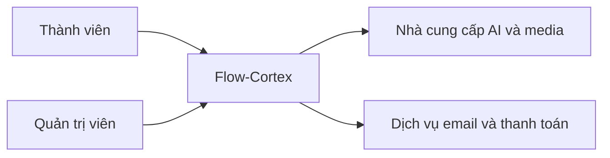
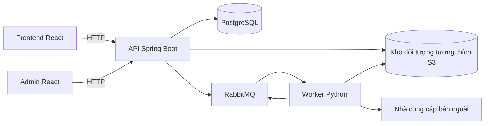
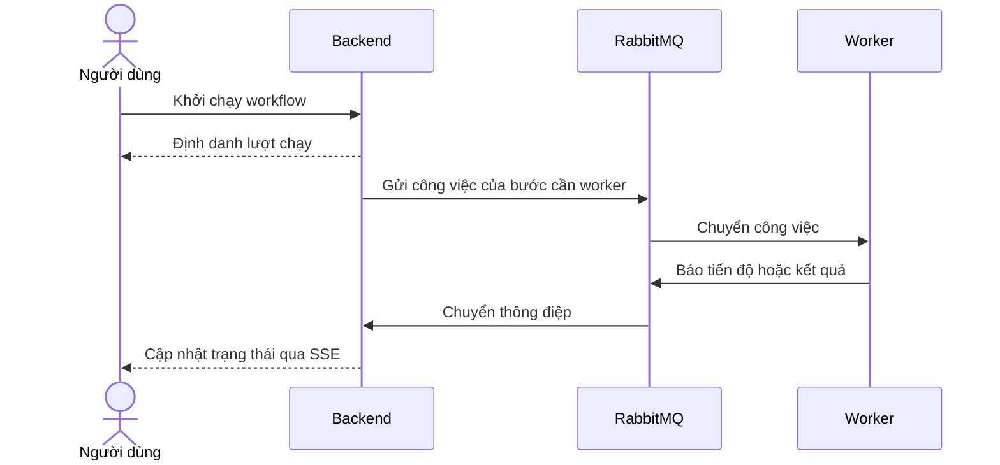
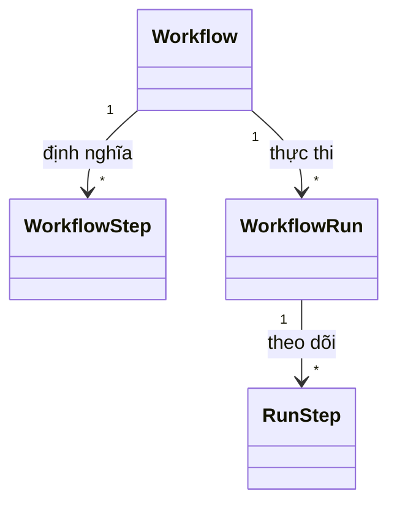

# Kiến trúc Flow-Cortex

## Ngữ cảnh

## Thành phần và triển khai

Backend tổ chức theo mô-đun nghiệp vụ. Các mô-đun trao đổi qua cổng công khai `api`. Frontend và admin dùng hợp đồng [OpenAPI](openapi.yaml). Các thông điệp giữa backend và worker có [schema trong contracts](../contracts/README.md). Cách chạy dịch vụ và cấu hình phát triển nằm trong [LOCAL_SETUP.md](../LOCAL_SETUP.md), còn cấu hình ghép dịch vụ nằm trong [Docker Compose](../docker-compose.yml). Các quyết định về Spring Modulith, RabbitMQ và SSE được ghi trong [ADR](ADR.md).

## Cơ chế thực thi workflow

Backend quản lý lượt chạy và từng bước. Các bước có thể xử lý tại backend, gửi công việc cho worker hoặc chờ đầu vào tùy định nghĩa. Các quan hệ sau là mô hình khái niệm. Tra khóa vật lý và dữ liệu lưu trữ trong [ERD](ERD.md).

Xem [Tạo video quảng cáo](features/product-video/README.md) để theo dõi một ví dụ có các bước tạo clip song song.
