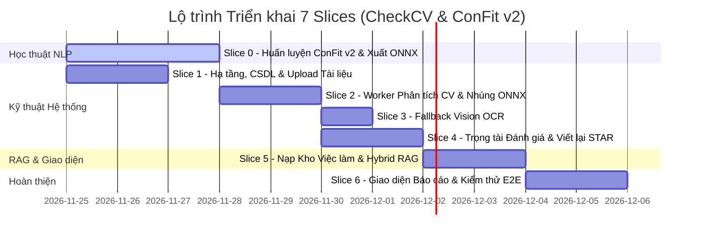

# Đặc tả Kỹ thuật Hệ thống CheckCV & Huấn luyện Mô hình ConFit v2 (ACL 2025)
**Dự án:** Flow-Cortex  
**Phiên bản:** 1.0.0  
**Tác giả:** Flow-Cortex Engineering & Research Team  
**Mục tiêu kép:** Workflow sản phẩm hoàn chỉnh cho Ứng viên (Candidate-First) & Đề tài Nghiên cứu / BTL môn Xử lý Ngôn ngữ Tự nhiên (NLP).

---

## 1. Tổng quan & 7 Quyết định Thiết kế Cốt lõi

Tài liệu này đặc tả toàn bộ kiến trúc, thuật toán, hợp đồng dữ liệu, quy trình huấn luyện mô hình học sâu và lộ trình tích hợp tính năng **CheckCV (Đánh giá CV & Gợi ý Việc làm Thông minh)** vào nền tảng **Flow-Cortex**. 

Hệ thống kết hợp mô hình Bi-Encoder Transformer tự huấn luyện theo công trình **ConFit v2 (Findings of ACL 2025)** chạy suy luận CPU-first cục bộ với chuỗi phân tích LLM đa tầng có kiểm định nghiêm ngặt (Neuro-Symbolic Arbiter) và công nghệ tìm kiếm việc làm kết hợp (Hybrid RAG: `pgvector` + PostgreSQL FTS + RRF).

### 7 Quyết định Thiết kế đã Chốt

| # | Hạng mục | Quyết định đã Chốt | Cơ sở Kỹ thuật |
|---|---|---|---|
| **1** | **Đối tượng sử dụng** | **Ứng viên (Candidate-First)** | Tập trung tối ưu trải nghiệm người tìm việc: soi chiếu CV theo chuẩn ATS, phát hiện lỗ hổng, viết lại kinh nghiệm và tìm việc làm phù hợp. |
| **2** | **Phạm vi MVP** | **1 CV + 1 JD / run** | Tập trung vào chiều sâu phân tích và đối soát chính xác giữa 1 hồ sơ và 1 bản mô tả công việc mục tiêu. |
| **3** | **Xử lý PDF Scan / Canva** | **Hybrid 2 tầng** | Tầng 1: `PyMuPDF` trích xuất nhanh; Tầng 2: tự động kích hoạt **Gemini Vision OCR** trên `provider-worker` khi text trích xuất bị rỗng/chất lượng kém. |
| **4** | **Bảo mật Dữ liệu (PII)** | **Zero-PII-to-LLM Mặc định** | Che toàn bộ số điện thoại, email, định danh cá nhân trước khi gửi tới LLM bên ngoài (tuân thủ `LlmJsonRequest` của Flow-Cortex). |
| **5** | **Chỉnh sửa CV** | **`rewrite_cv` + `APPROVAL_CHECKPOINT`** | Tự động viết lại bullet points theo chuẩn STAR/XYZ (No-Fake-Metrics) và dừng tại checkpoint để người dùng chủ động duyệt trước khi hoàn tất. |
| **6** | **Nạp Kho Việc làm** | **Job Ingestion CLI** | Script ngoại tuyến nạp 200–1000 tin tuyển dụng thực tế (kèm `source_url` & `expires_at`), sinh HYRE và nhúng vector bằng mô hình ConFit-v2 ONNX. |
| **7** | **Gợi ý Việc làm** | **Bước `recommend_jobs` có Toggle** | Chạy mặc định ở cuối workflow; người dùng có thể chủ động bật/tắt trên Form khởi chạy nếu chỉ muốn chấm điểm CV đơn thuần. |

---

## 2. Cơ sở Khoa học & Các Công trình Trích dẫn

1. **Mô hình Huấn luyện Lõi (ConFit v2):**  
   *Yu, Xu, Xue, Zhang, Ma & Yu (2025). "ConFit v2: Improving Resume-Job Matching using Hypothetical Resume Embedding and Runner-Up Hard-Negative Mining."* **Findings of ACL 2025**.  
   *Đóng góp:* Loại bỏ attention phân cấp rườm rà, dùng Bi-Encoder rút gọn (Mean Pooling), bổ sung kỹ thuật làm giàu văn cảnh **HYRE** và khai thác mẫu âm khó á quân **RUM**.
2. **Khung Chuẩn Năng lực & Đánh giá Tuyển dụng:**  
   *Schmidt & Hunter (1998)*; Khung năng lực tiêu chuẩn **ESCO / O\*NET**.  
   *Đóng góp:* Phân rã rubric kỹ năng và kinh nghiệm thành các tầng trọng số Essential (`2x`) và Optional (`1x`) có trần điểm chặn cứng.
3. **Mô hình Khớp Nối Phân cấp có Bằng chứng:**  
   *Zhu et al. (2018)* (**PJFNN**, ACM TMIS); *Qin et al. (2018, 2020)* (**APJFNN**, ACM SIGIR / TOIS).  
   *Đóng góp:* Khớp từng yêu cầu trong JD với các khối kinh nghiệm trong CV thông qua chỉ mục `evidenceBlockIds`.
4. **Đánh giá Khách quan qua LLM-as-a-Judge:**  
   *Liu et al. (2023)* (**G-Eval**, EMNLP 2023); *Zheng et al. (2023)* (NeurIPS 2023).  
   *Đóng góp:* Dùng rubric thang đo rời rạc có neo ngữ cảnh kết hợp Chain-of-Thought để triệt tiêu hiện tượng thiên lệch độ dài (verbosity bias).
5. **Dung hợp Tìm kiếm Kết hợp (Hybrid Search Fusion):**  
   *Cormack, Clarke & Büttcher (2009). "Reciprocal Rank Fusion Outperforms Condorcet and Individual Rank Learning Methods."* **ACM SIGIR 2009**.  
   *Đóng góp:* Trộn kết quả tìm kiếm ngữ nghĩa Dense (ConFit v2 + `pgvector`) và tìm kiếm từ khóa Sparse (PostgreSQL FTS) với tham số $k = 60$.
6. **Đánh giá Chống Ảo giác RAG:**  
   *Es et al. (2024)* (**RAGAS**, EACL 2024).  
   *Đóng góp:* Đo lường độ trung thực (`Faithfulness`) và độ chính xác ngữ cảnh (`Context Precision`) của hệ thống giải thích độ tương thích công việc.

---

## 3. Kiến trúc Tổng thể & Luồng Thực thi (Workflow DAG)

Workflow `check_cv` được tổ chức dưới dạng Directed Acyclic Graph (DAG) tuân thủ kiến trúc phân tầng sẵn có của Flow-Cortex:

```
[1. ingest_document] (Backend: IngestStepExecutor)
        │   - Presigned URL S3
        │   - Kiểm tra Magic Bytes Tầng 1 (PDF / DOCX <= 10MB)
        ▼
[2. parse_cv] (REMOTE -> media.jobs: Keyless Python Worker)
        │   - PyMuPDF / python-docx (Bảo vệ chống ZIP bomb)
        │   - ATS X-Ray: Cấu trúc cột, bảng biểu, phát hiện chữ ẩn/prompt injection
        │   - Che PII (Zero-PII-to-LLM)
        │   - Nhúng ConFit-v2 ONNX: Sinh cv_embedding (768-dim) + confit_cosine_sim
        ├────────────────────────────────────┐
        │ (needsVisionOcr == false)          │ (needsVisionOcr == true: file scan / Canva)
        ▼                                    ▼
        │                         [3. ocr_document] (REMOTE -> provider.jobs)
        │                                    │   - Gemini 2.5 Flash Vision OCR
        ├────────────────────────────────────┘
        ▼
[4. evaluate_cv] (Backend: INLINE Provider Pool + CvEvaluationArbiter)
        │   - CvValidityGate (Tầng 3: Kiểm tra tính hợp lệ của CV & JD)
        │   - LlmSlots: LLM chấm rubric 5 trụ cột kèm evidenceBlockIds[]
        │   - CvEvaluationArbiter (Pure Java): Kiểm toán timeline, xác thực blockId,
        │     tích hợp confit_cosine_sim, áp Hard-Gate Cap (trần điểm 65/45)
        ▼
[5. rewrite_cv] (Backend: INLINE Provider Pool + APPROVAL_CHECKPOINT)
        │   - LlmSlots: Viết lại Top 5–8 bullet points theo STAR/XYZ (No-Fake-Metrics)
        │   - Dừng tại APPROVAL_CHECKPOINT chờ người dùng duyệt/sửa
        ▼
[6. recommend_jobs] (Backend: INLINE + pgvector/tsvector RRF - Có thể tắt qua Toggle)
        │   - Dense Search (HNSW Cosine trên cv_embedding)
        │   - Sparse Search (GIN tsvector FTS)
        │   - Lọc metadata (expires_at > NOW(), seniority)
        │   - Dung hợp RRF (k=60) -> LLM Rerank Top 5 kèm giải thích & Skill Gap
        ▼
     [KẾT QUẢ HOÀN TẤT]
```

---

## 4. Chi tiết Các Bước Thực thi trong Workflow

### Bước 1: `ingest_document`
- **Môi trường thực thi:** Backend (`IngestStepExecutor`).
- **Nhiệm vụ:** Cấp presigned URL để client tải trực tiếp file lên bucket S3 (`raw/`).
- **Cổng Kiểm định Tầng 1 (`ContentSniffer` & `UploadPurposePolicy`):**
  - Giới hạn kích thước: `1 Byte <= file_size <= 10 MB`.
  - Kiểm tra Magic Bytes:
    - PDF: bắt buộc bắt đầu bằng `%PDF-` (`0x25 0x50 0x44 0x46 0x2D`).
    - DOCX: bắt buộc bắt đầu bằng `PK\x03\x04` (`0x50 0x4B 0x03 0x04`) và chứa cấu trúc `[Content_Types].xml`.
  - Nếu vi phạm: Trả về HTTP 422 ngay lập tức, ghi log kiểm toán, tiêu tốn 0 credit.

### Bước 2: `parse_cv`
- **Môi trường thực thi:** Python Worker (Hàng đợi `media.jobs` — Container Keyless, không có quyền kết nối Internet).
- **Cổng Kiểm định Tầng 2 (Cấu trúc & An toàn):**
  - Số trang: `1 <= page_count <= 10`.
  - Chống DOCX ZIP bomb: Giới hạn giải nén tối đa `25 MB`, tỷ lệ nén `ratio <= 100`.
  - Kiểm tra tính toàn vẹn (từ chối file có mật khẩu bảo vệ hoặc bị lỗi định dạng nhị phân).
- **Phân tích ATS X-Ray:**
  - Áp dụng thuật toán XY-Cut phân tích thứ tự đọc cho văn bản nhiều cột.
  - Quét tìm chữ ẩn (text màu trắng `#FFFFFF`, cỡ chữ `< 4pt`, hoặc tọa độ nằm ngoài lề trang in) nhằm ngăn chặn gian lận ATS và Prompt Injection.
  - Render từng trang thành file ảnh PNG độ phân giải 150 DPI tải lên S3 phục vụ hiển thị Split-View trên giao diện.
- **Đánh giá Chất lượng Ký tự:**
  - Nếu số ký tự trích xuất `< 150` hoặc tỷ lệ từ vựng hợp lệ quá thấp (dấu hiệu của CV vẽ bằng Canva phẳng hoặc ảnh scan), worker đánh dấu cờ `needsVisionOcr = true`.
- **Khử Định danh (Zero-PII-to-LLM):**
  - Tự động phát hiện và thay thế bằng nhãn chuẩn hóa:
    - Điện thoại $\rightarrow$ `[PHONE_REDACTED]`
    - Email $\rightarrow$ `[EMAIL_REDACTED]`
    - Link cá nhân $\rightarrow$ `[LINK_REDACTED]`
    - Họ tên ứng viên $\rightarrow$ `[CANDIDATE_NAME]`
  - Chia toàn bộ nội dung CV thành danh sách các khối `blocks` có định danh duy nhất `blockId` (ví dụ: `exp_0_bullet_1`, `edu_1`).
- **Nhúng Mô hình ConFit-v2 ONNX:**
  - Tải file trọng số `confit_v2.onnx` trên CPU thông qua thư viện `onnxruntime` và `tokenizers`.
  - Sinh vector đại diện ngữ nghĩa **768 chiều** cho CV (`cv_embedding`).
  - Nếu có văn bản JD mục tiêu, tính điểm độ tương đồng Cosine chuẩn hóa:
    $$\text{confit\_cosine\_sim} = \frac{f_\theta(\text{CV}) \cdot f_\theta(\text{JD}_{\text{HYRE}})}{\|f_\theta(\text{CV})\|_2 \, \|f_\theta(\text{JD}_{\text{HYRE}})\|_2}$$

### Bước 3: `ocr_document` (Có điều kiện)
- **Môi trường thực thi:** Provider Worker (Hàng đợi `provider.jobs` — có kết nối ra ngoài qua `egress-proxy`).
- **Điều kiện kích hoạt:** Chỉ chạy khi `needsVisionOcr == true`.
- **Nhiệm vụ:** Gửi ảnh các trang CV sang **Gemini 2.5 Flash Vision** kèm prompt trích xuất văn bản có cấu trúc chuẩn, bảo toàn vị trí bảng biểu và danh mục kỹ năng.
- **Tối ưu chi phí:** Nếu bước `parse_cv` đã trích xuất văn bản thành công, bước này được bỏ qua hoàn toàn (0 credit OCR).

### Bước 4: `evaluate_cv`
- **Môi trường thực thi:** Backend (`EvaluateCvStepExecutor` phối hợp với `CvEvaluationArbiter`).
- **Cổng Kiểm định Tầng 3 (`CvValidityGate`):**
  - Yêu cầu tối thiểu `>= 80 từ` đối với CV và `>= 30 từ` đối với JD.
  - Kiểm tra sự hiện diện của tối thiểu `2/5` nhóm mục cơ bản (Học vấn, Kinh nghiệm, Kỹ năng, Dự án, Thông tin chung).
  - Phân loại trạng thái: `VALID_CV`, `INCOMPLETE_CV`, hoặc `NOT_A_CV`. Nếu phát hiện văn bản không phải CV (hóa đơn, bài tập, slide), workflow dừng lại ngay lập tức và gắn cờ cảnh báo.
- **Chấm điểm Rubric qua LLM (`LlmSlots`):**
  - Truyền văn bản CV (đã che PII và gắn mã `blockId`) cùng JD mục tiêu vào LLM.
  - Áp dụng thang đo neo rời rạc 0–3 điểm cho từng tiêu chí nhỏ.
  - Bắt buộc LLM phải viện dẫn danh sách `evidenceBlockIds[]` cho mọi nhận xét (điểm mạnh hoặc lỗ hổng).
- **Bộ Trọng tài Độc lập (`CvEvaluationArbiter` - Pure Java):**
  - **Kiểm tra Đối soát Bằng chứng:** Đối chiếu mọi `evidenceBlockIds[]` do LLM trả về với danh sách block thực tế trong `parsed_cv.json`. Nếu LLM viện dẫn mã không tồn tại, nhận xét bị hạ cấp xuống `UNVERIFIED`.
  - **Kiểm toán Dòng thời gian:** Tự động tính toán tổng số tháng kinh nghiệm thực tế, phát hiện các khoảng trống không làm việc (`gaps > 6 tháng`) hoặc các khoảng thời gian chồng chéo bất hợp lý.
  - **Tích hợp Tín hiệu ConFit v2:**
    $$S_{\text{skills\_fit}} = 0.70 \cdot S_{\text{rubric\_skills}} + 0.30 \cdot S_{\text{confit}}$$
  - **Tính điểm 5 Trụ cột Thích ứng theo Cấp bậc:**
    - *Junior / Mid:* Kỹ năng (35%) + Kinh nghiệm (25%) + Số liệu tác động (15%) + Chuẩn ATS (15%) + Trình bày (10%).
    - *Senior / Lead:* Kỹ năng (30%) + Kinh nghiệm (30%) + Số liệu tác động (20%) + Chuẩn ATS (10%) + Trình bày (10%).
    - *Intern / Fresher:* Kỹ năng (40%) + Kinh nghiệm/Dự án (15%) + Tác động (15%) + Chuẩn ATS (20%) + Trình bày (10%).
  - **Quy tắc Chặn trần Điểm (Hard-Gate Cap):**
    - Nếu không đáp ứng 1 yêu cầu bắt buộc (Must-Have) $\rightarrow$ Điểm tổng tối đa không vượt quá **65/100**.
    - Nếu không đáp ứng $\ge 2$ yêu cầu bắt buộc $\rightarrow$ Điểm tổng tối đa không vượt quá **45/100**.

### Bước 5: `rewrite_cv`
- **Môi trường thực thi:** Backend (`RewriteCvStepExecutor` phối hợp với `APPROVAL_CHECKPOINT`).
- **Nhiệm vụ:** Chọn lọc Top 5–8 bullet points yếu nhất trong phần Kinh nghiệm/Dự án và tạo bản viết lại theo nguyên tắc:
  - Cấu trúc **STAR (Situation, Task, Action, Result)** hoặc **Google XYZ** *(Accomplished [X] as measured by [Y], by doing [Z])*.
  - **Quy tắc No-Fake-Metrics:** Cấm tuyệt đối việc LLM tự bịa đặt số liệu (ví dụ: tự ý thêm "tăng 30% doanh thu"). Nếu văn bản gốc thiếu dữ kiện định lượng, LLM bắt buộc phải chèn thẻ giữ chỗ: `"[Điền số liệu thực tế: ví dụ giảm X giờ xử lý hoặc tiết kiệm Y% chi phí]"`.
- **Tạm dừng tại Checkpoint:** Workflow chuyển sang trạng thái tạm dừng `WAITING_FOR_APPROVAL` để ứng viên trực tiếp xem xét, duyệt hoặc chỉnh sửa trước khi hoàn tất.

### Bước 6: `recommend_jobs` (Có thể bật/tắt)
- **Môi trường thực thi:** Backend (`RecommendJobsStepExecutor`).
- **Cơ chế Tìm kiếm Kết hợp (Hybrid RAG):**
  1. *Dense Vector Search:* Truy vấn khoảng cách Cosine trên cột `embedding vector(768)` của bảng `job_posting` sử dụng chỉ mục HNSW với vector đầu vào là `cv_embedding`.
  2. *Sparse Keyword Search:* Truy vấn từ khóa trên cột `tsv tsvector` sử dụng chỉ mục GIN.
  3. *Lọc Dữ liệu Hợp lệ:* Bắt buộc thỏa mãn điều kiện `expires_at > NOW()` và tương thích cấp bậc seniority.
  4. *Dung hợp Xếp hạng RRF ($k = 60$):*
     $$\text{RRF\_Score}(d) = \frac{1}{60 + \text{rank}_{\text{dense}}(d)} + \frac{1}{60 + \text{rank}_{\text{sparse}}(d)}$$
  5. *LLM Rerank & Báo cáo Tương thích:* Lấy Top 15 kết quả sau RRF, đưa qua LLM để chọn ra Top 5 vị trí xuất sắc nhất, đồng thời sinh bảng đối soát kỹ năng (Skill Gap Analysis) giải thích rõ những kỹ năng ứng viên đã có và kỹ năng cần bổ sung thêm.

---

## 5. Đặc tả Huấn luyện Mô hình ConFit v2 (ACL 2025)

### 5.1. Kiến trúc Mô hình (Model Architecture)
- **Mô hình nền tảng (Backbone):** `intfloat/multilingual-e5-base` (278M tham số, 768 chiều vector, hỗ trợ vượt trội văn bản song ngữ Việt – Anh).
- **Cơ chế mã hóa (Dual-Encoder):** Áp dụng **Mean Pooling** trên token embeddings của lớp cuối cùng, sau đó chuẩn hóa vector qua $L_2$ norm. Loại bỏ toàn bộ các lớp attention và MLP phức tạp giữa các trường dữ liệu theo đúng kiến trúc tối giản **ConFit\*** của bài báo.
- **Tiền tố (Prefixes):**
  - Phía CV: `"query: ## Education: ... ## Skills: ... ## Experience: ..."`
  - Phía JD: `"passage: ## Job Title: ... ## Requirements: ... [HYPOTHETICAL RESUME] ..."`

### 5.2. Hai Kỹ thuật Cốt lõi của Bài báo
1. **HYRE (Hypothetical Resume Embedding):**
   - Với mỗi bản mô tả công việc (JD), sử dụng LLM tạo một bản CV giả định hoàn hảo mang đầy đủ các kỹ năng và kinh nghiệm lý tưởng mà nhà tuyển dụng tìm kiếm.
   - Ghép nối dữ liệu: $J_{\text{HYRE}} = J + \text{"\n[HYPOTHETICAL RESUME]\n"} + R_{\text{hypo}}$.
   - Tác dụng: Xóa bỏ sự bất đối xứng văn phong giữa JD (ngắn gọn, mang tính yêu cầu) và CV (chi tiết, mang tính mô tả thành tích).
2. **RUM (Runner-Up Hard-Negative Mining):**
   - Sử dụng mô hình ở giai đoạn warm-up để tính toán ma trận tương đồng cosine giữa toàn bộ tập CV và JD.
   - Thay vì lấy Top 1 làm mẫu âm (dễ rơi vào các ứng viên xuất sắc nhưng chưa nộp đơn – False Negatives), RUM trích xuất các mẫu âm nằm trong dải **Top 3% – 4%** (dải á quân có điểm cao nhưng thực tế là mẫu bị từ chối) để làm tập Hard Negatives $\mathcal{N}_{\text{RUM}}$.

### 5.3. Hàm Mục tiêu & Tham số Huấn luyện
- **Hàm Loss:** Contrastive InfoNCE Loss với Hard Negatives:
  $$\mathcal{L} = -\frac{1}{B} \sum_{i=1}^{B} \log \frac{\exp\big(\cos(R_i, J_i^+) / \tau\big)}{\exp\big(\cos(R_i, J_i^+) / \tau\big) + \sum_{k=1}^{K} \exp\big(\cos(R_i, J_{i, k}^-) / \tau\big)}$$
- **Siêu tham số:**
  - Nhiệt độ: $\tau = 0.05$.
  - Tối ưu hóa: AdamW, Learning Rate = $2 \times 10^{-5}$, Linear Warmup 10%.
  - Kỹ thuật PEFT: **LoRA** (`r=16, lora_alpha=32, lora_dropout=0.05` gắn trên các module `query, key, value, dense`).
  - Batch Size: 8; Số lượng mẫu âm khó: $K = 2$ cho mỗi mẫu dương.
  - Môi trường: 1x GPU T4 16GB (Google Colab hoặc Kaggle), thời gian huấn luyện khoảng 30–45 phút.

### 5.4. Tập Dữ liệu Chính thức & Quy chuẩn Ánh xạ Schema ConFit v2
- **Tập Dữ liệu Huấn luyện & Kiểm chuẩn Chính thức (Đã Chốt):**
  - **Tập tiếng Anh Chuẩn:** `cnamuangtoun/resume-job-description-fit` trên HuggingFace (~8,000 cặp CV–JD có văn bản tiếng Anh thật 100%, có nhãn phân loại 3 mức: *Good Fit / Potential Fit / No Fit*).
  - **Tập mở rộng Song ngữ Việt – Anh:** 200–300 tin tuyển dụng IT tại Việt Nam (thu thập từ TopCV/VietnamWorks, đã làm sạch PII) kèm 50–100 CV mẫu ẩn danh để tối ưu hóa năng lực Domain Adaptation cho thị trường Việt Nam.
- **Quy chuẩn Ánh xạ sang Schema Gốc của ConFit v2 (`recruiting_data_v2`):**
  Dựa trên cấu trúc chuẩn từ mã nguồn chính thức của bài báo, dữ liệu được chuyển đổi thành 3 tệp định dạng chuẩn:
  1. `all_jd_full_from_text_recruiting_data.csv`: Gồm 2 cột `jd_no` (mã băm ID công việc) và `text_job` (toàn bộ nội dung JD sau khi ghép nối HYRE).
  2. `all_resume_full_desensitized_recruiting_data.csv`: Gồm 2 cột `user_id` (mã băm ID ứng viên) và `text_resume` (toàn bộ nội dung CV đã che PII).
  3. `train_labeled_data.jsonl` / `valid_classification_data.jsonl` / `test_classification_data.jsonl`: Mỗi dòng là một JSON `{"user_id": "...", "jd_no": "...", "satisfied": 1}` trong đó:
     - Nhãn `Good Fit` $\rightarrow$ `satisfied = 1` (Cặp dương).
     - Nhãn `No Fit` $\rightarrow$ `satisfied = 0` (Cặp âm cơ bản).
     - Mẫu âm khó được sinh tự động bởi thuật toán **RUM** lưu tại `hard_negatives.json`.
  4. `rank_resume.json` và `rank_job.json`: Bộ chỉ mục đối soát đánh giá xếp hạng nDCG@10, nDCG@100, Recall@10, Recall@100 theo đúng benchmark chuẩn của bài báo.
- **Phân chia Dữ liệu:** Áp dụng **Group Split 80/10/10 theo Resume ID** (`user_id`) để đảm bảo không rò rỉ dữ liệu (0% Data Leakage).

- **Ma trận Thực nghiệm Ablation Study cho Báo cáo NLP:**

| Cấu hình Thử nghiệm | Matching Accuracy (%) | Macro-F1 (%) | Spearman $\rho$ | Retrieval NDCG@10 | Retrieval Recall@15 |
|---|---|---|---|---|---|
| **Baseline 1:** BM25 / FTS | — | — | — | Báo cáo thực nghiệm | Báo cáo thực nghiệm |
| **Baseline 2:** Zero-shot `multilingual-e5-base` | Báo cáo | Báo cáo | Báo cáo | Báo cáo | Báo cáo |
| **Ablation 1:** mE5 + LoRA + InfoNCE (In-Batch only) | Báo cáo | Báo cáo | Báo cáo | Báo cáo | Báo cáo |
| **Ablation 2:** mE5 + LoRA + InfoNCE + **HYRE** | Báo cáo | Báo cáo | Báo cáo | Báo cáo | Báo cáo |
| **Full ConFit v2:** mE5 + LoRA + InfoNCE + **HYRE + RUM** | **Kỳ vọng cao nhất** | **Kỳ vọng cao nhất** | **Kỳ vọng cao nhất** | **Kỳ vọng cao nhất** | **Kỳ vọng cao nhất** |

### 5.5. Đóng gói & Tích hợp ONNX (CPU Inference)
- Sau khi huấn luyện, merge LoRA weights vào mô hình gốc và xuất sang định dạng ONNX:
  ```bash
  optimum-cli export onnx --model ./checkpoint-best --task feature-extraction ./confit_v2_onnx/
  ```
- Áp dụng kỹ thuật lượng hóa động (Dynamic Quantization INT8) giúp giảm kích thước còn ~**280 MB**.
- File model được nạp trong `media-worker` thông qua `onnxruntime`, đảm bảo tốc độ sinh vector `< 150 ms` trên CPU bình thường mà không cần GPU.

---

## 6. Thiết kế Cơ sở Dữ liệu & Hợp đồng (Contracts)

### 6.1. Migration CSDL (`PostgreSQL 17 + pgvector`)
Tạo file migration tại `backend/boot/app/src/main/resources/db/migration/V2026.11.25.100__checkcv_and_job_posting.sql`:

```sql
-- Kích hoạt extension vector
CREATE EXTENSION IF NOT EXISTS vector;

-- Bảng lưu trữ kho tin tuyển dụng phục vụ Job RAG
CREATE TABLE IF NOT EXISTS job_posting (
    id VARCHAR(64) PRIMARY KEY,
    title VARCHAR(255) NOT NULL,
    company_name VARCHAR(255) NOT NULL,
    location VARCHAR(128) NOT NULL,
    seniority_level VARCHAR(64) NOT NULL,
    description_text TEXT NOT NULL,
    hyre_text TEXT,
    source_url VARCHAR(1024) NOT NULL,
    expires_at TIMESTAMPTZ NOT NULL,
    created_at TIMESTAMPTZ NOT NULL DEFAULT NOW(),
    
    -- Vector ngữ nghĩa 768 chiều từ ConFit v2
    embedding vector(768),
    
    -- Cột Full-Text Search tự động
    tsv tsvector GENERATED ALWAYS AS (
        to_tsvector('simple', coalesce(title, '') || ' ' || coalesce(description_text, ''))
    ) STORED
);

-- Chỉ mục HNSW cho tìm kiếm Vector (khoảng cách Cosine)
CREATE INDEX IF NOT EXISTS idx_job_posting_embedding_hnsw 
ON job_posting USING hnsw (embedding vector_cosine_ops)
WITH (m = 16, ef_construction = 64);

-- Chỉ mục GIN cho tìm kiếm từ khóa FTS
CREATE INDEX IF NOT EXISTS idx_job_posting_tsv 
ON job_posting USING gin (tsv);

-- Chỉ mục B-Tree cho bộ lọc trạng thái và cấp bậc
CREATE INDEX IF NOT EXISTS idx_job_posting_filter 
ON job_posting (expires_at, seniority_level);

-- Bổ sung đơn giá năng lực vào hệ thống tính cước
INSERT INTO capability_pricing (capability, cost_cents, credit_units) VALUES
    ('ingest_document', 0, 0),
    ('parse_cv', 5, 1),
    ('ocr_document', 20, 4),
    ('evaluate_cv', 15, 3),
    ('rewrite_cv', 10, 2),
    ('recommend_jobs', 5, 1)
ON CONFLICT (capability) DO NOTHING;
```

### 6.2. JSON Schema Kết quả Đánh giá (`contracts/cv-evaluation.schema.json`)
```json
{
  "$schema": "http://json-schema.org/draft-07/schema#",
  "title": "CvEvaluationResult",
  "type": "object",
  "required": [
    "overallScore",
    "seniorityLevel",
    "pillarScores",
    "confitMetrics",
    "atsAnalysis",
    "timelineAudit",
    "unfulfilledMustHaves",
    "strengths",
    "weaknesses"
  ],
  "properties": {
    "overallScore": { "type": "integer", "minimum": 0, "maximum": 100 },
    "hardGateCapped": { "type": "boolean" },
    "seniorityLevel": { "type": "string", "enum": ["INTERN", "FRESHER", "JUNIOR", "MID", "SENIOR", "LEAD"] },
    "confitMetrics": {
      "type": "object",
      "required": ["semanticFitScore", "cosineSimilarity"],
      "properties": {
        "semanticFitScore": { "type": "number", "minimum": 0, "maximum": 100 },
        "cosineSimilarity": { "type": "number", "minimum": -1, "maximum": 1 }
      }
    },
    "pillarScores": {
      "type": "object",
      "required": ["skillsFit", "experienceDepth", "impactMetrics", "atsReadability", "structureClarity"],
      "properties": {
        "skillsFit": { "type": "integer", "minimum": 0, "maximum": 100 },
        "experienceDepth": { "type": "integer", "minimum": 0, "maximum": 100 },
        "impactMetrics": { "type": "integer", "minimum": 0, "maximum": 100 },
        "atsReadability": { "type": "integer", "minimum": 0, "maximum": 100 },
        "structureClarity": { "type": "integer", "minimum": 0, "maximum": 100 }
      }
    },
    "atsAnalysis": {
      "type": "object",
      "required": ["cleanTextRatio", "hiddenTextDetected", "multiColumnRisk"],
      "properties": {
        "cleanTextRatio": { "type": "number" },
        "hiddenTextDetected": { "type": "boolean" },
        "multiColumnRisk": { "type": "boolean" }
      }
    },
    "timelineAudit": {
      "type": "object",
      "required": ["totalExperienceMonths", "gapsDetected", "overlapsDetected"],
      "properties": {
        "totalExperienceMonths": { "type": "integer" },
        "gapsDetected": { "type": "array", "items": { "type": "string" } },
        "overlapsDetected": { "type": "array", "items": { "type": "string" } }
      }
    },
    "unfulfilledMustHaves": { "type": "array", "items": { "type": "string" } },
    "strengths": {
      "type": "array",
      "items": {
        "type": "object",
        "required": ["claim", "evidenceBlockIds"],
        "properties": {
          "claim": { "type": "string" },
          "evidenceBlockIds": { "type": "array", "items": { "type": "string" } }
        }
      }
    },
    "weaknesses": {
      "type": "array",
      "items": {
        "type": "object",
        "required": ["issue", "recommendation", "evidenceBlockIds"],
        "properties": {
          "issue": { "type": "string" },
          "recommendation": { "type": "string" },
          "evidenceBlockIds": { "type": "array", "items": { "type": "string" } }
        }
      }
    }
  }
}
```

---

## 7. Thiết kế Giao diện Người dùng (Frontend UI/UX)

### 7.1. Form Khởi chạy Workflow (`CheckCvStartForm.tsx`)
- Khu vực kéo thả file CV: Hỗ trợ tệp `.pdf` và `.docx`, kiểm tra dung lượng `<= 10 MB` phía client.
- Hộp nhập văn bản Mô tả Công việc (Job Description).
- Menu chọn Cấp bậc Ứng tuyển: `Intern` / `Fresher` / `Junior` / `Mid` / `Senior` / `Lead`.
- Công tắc bật/tắt: `[x] Tự động tìm kiếm và gợi ý việc làm phù hợp (Hybrid RAG)`.

### 7.2. Màn hình Báo cáo Tương tác (`CheckCvReportView.tsx`)
- **Bố cục Split-View (Chia đôi màn hình):**
  - **Khung bên trái (Tài liệu CV trực quan):**
    - Hiển thị từng trang CV dưới dạng ảnh sắc nét.
    - Công tắc chuyển đổi: **Chế độ Gốc ↔ Chế độ ATS X-Ray** (hiển thị văn bản dạng thô mà robot ATS thu nhận).
    - Tương tác thông minh: Khi ứng viên nhấp vào bất kỳ nhận xét nào ở bảng bên phải, khung bên trái tự động cuộn đến trang tương ứng và vẽ khung nổi bật (highlight bounding box) xung quanh đoạn văn bản liên quan.
  - **Khung bên phải (Bảng Phân tích 5 Tabs):**
    - **Tab 1: Điểm số & Tổng quan:** Hiển thị điểm tổng 100, biểu đồ radar 5 tiêu chí, chỉ số tương đồng ConFit v2, cảnh báo giới hạn điểm nếu trượt yêu cầu bắt buộc, và công cụ mô phỏng điểm số `What-If Simulator` khi hoàn thành các khuyến nghị.
    - **Tab 2: Lỗ hổng & Must-Haves:** Danh sách chi tiết các tiêu chuẩn chưa đạt cùng báo cáo khoảng trống thời gian (timeline gaps).
    - **Tab 3: Chỉnh sửa STAR/XYZ:** Danh sách các gạch đầu dòng được viết lại kèm nút bấm "Chấp thuận" hoặc sửa đổi thông tin số liệu thực tế.
    - **Tab 4: Câu hỏi Phỏng vấn:** Dự đoán các câu hỏi xoáy sâu vào điểm yếu trong hồ sơ kèm khung gợi ý câu trả lời.
    - **Tab 5: Việc làm Phù hợp (RAG):** Danh sách Top 5 công việc tương thích nhất từ cơ sở dữ liệu kèm tỷ lệ khớp %, phân tích khoảng cách kỹ năng (Skill Gap), đường dẫn ứng tuyển gốc và nút bấm *"Chấm điểm lại CV với vị trí này"*.

---

## 8. Lộ trình Triển khai Chi tiết theo 7 Slices



### Chi tiết Tiêu chí Hoàn thành từng Slice:
- **Slice 0:** Hoàn thành mã nguồn tại `ml/confit_v2/`, chạy huấn luyện trên Colab GPU, xuất bảng số liệu Ablation Study cho báo cáo NLP và file trọng số `confit_v2.onnx` đạt độ trễ suy luận `< 150 ms` trên CPU.
- **Slice 1:** Bật `pgvector` trên Postgres 17; tạo bảng `job_posting` qua migration Flyway; cài đặt `IngestStepExecutor` kiểm soát chặt chẽ file PDF/DOCX.
- **Slice 2:** Xây dựng `parse_cv` trong Python worker: trích xuất XY-cut, quét chữ ẩn ATS X-Ray, che PII và nhúng `confit_v2.onnx` sinh `cv_embedding` cùng `confit_cosine_sim`.
- **Slice 3:** Xây dựng `ocr_document` trên `provider-worker` kết nối Gemini Vision OCR khi cờ `needsVisionOcr == true`.
- **Slice 4:** Cài đặt `CvValidityGate`, `CvEvaluationArbiter` (Java deterministic), các bước `evaluate_cv` và `rewrite_cv` có `APPROVAL_CHECKPOINT`.
- **Slice 5:** Xây dựng script `scripts/ingest_jobs.py` nạp kho tin tuyển dụng (sinh HYRE và tạo vector bằng ConFit-v2 ONNX) và cài đặt `RecommendJobsStepExecutor` dùng thuật toán RRF ($k=60$).
- **Slice 6:** Phát triển giao diện người dùng Form khởi chạy và Báo cáo Split-View 5 Tabs; đồng bộ hợp đồng OpenAPI client; hoàn tất kiểm toán an toàn Zero-PII-Log.
