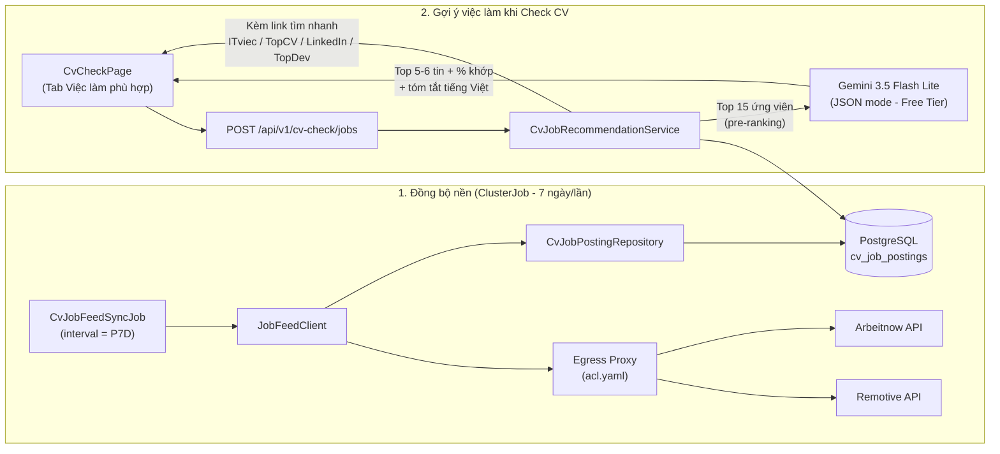

# Hướng dẫn Triển khai Tích hợp Remotive & Arbeitnow API cho Chức năng Check CV

Tài liệu này mô tả chi tiết cách tích hợp hai nguồn API việc làm công khai miễn phí (**Remotive** và **Arbeitnow**) vào dự án **Flow-Cortex**, kèm cơ chế **tự động làm mới định kỳ 7 ngày/lần** bằng `ClusterJob` và **đề xuất việc làm phù hợp theo CV** bằng Gemini (Free Tier JSON mode).

---

## 1. Tổng quan kiến trúc

Thay vì gọi trực tiếp API bên ngoài mỗi khi người dùng kiểm tra CV (dễ chậm, dễ lỗi mạng hoặc chạm rate limit), hệ thống tách làm **2 luồng độc lập**:

1. **Luồng đồng bộ nền (Background Sync — 7 ngày/lần):** `ClusterJob` định kỳ gọi Remotive API và Arbeitnow API thông qua `egress-proxy`, chuẩn hóa dữ liệu rồi lưu (`upsert`) vào bảng PostgreSQL `cv_job_postings`, đồng thời dọn dẹp các tin cũ quá 14 ngày.
2. **Luồng gợi ý việc làm (Runtime — theo từng CV):** Khi người dùng chấm điểm CV, Backend đọc danh sách tin mới nhất từ PostgreSQL, chấm điểm sơ bộ (pre-ranking) chọn Top 15 tin sát nhất rồi gửi qua `gemini-3.5-flash-lite` (JSON mode thường, 0 đồng trên Free Tier) để chọn ra Top 5–6 tin khớp nhất kèm `% phù hợp` và tóm tắt tiếng Việt.



---

## 2. Nguồn API việc làm công khai (Miễn phí 100%, không cần API Key)

### 2.1. Remotive API
- **Endpoint:** `GET https://remotive.com/api/remote-jobs?category=software-dev&limit=100`
- **Cấu trúc JSON trả về:** Mảng `jobs[]` gồm các trường chính:
  - `id` → `externalId`
  - `title` → `title`
  - `company_name` → `company`
  - `candidate_required_location` → `location` (mặc định `"Worldwide"`)
  - `salary` → `salary`
  - `job_type` → `workMode` (chuẩn hóa dạng `"Remote · full time"`)
  - `tags` → `tags` (tối đa 12 tag)
  - `description` (HTML) → loại bỏ thẻ HTML, rút gọn tối đa 500 ký tự
  - `url` → `applyUrl`
  - `publication_date` (ISO-8601) → `publishedAt`

### 2.2. Arbeitnow API
- **Endpoint:** `GET https://www.arbeitnow.com/api/job-board-api?page={1..2}`
- **Cấu trúc JSON trả về:** Mảng `data[]` gồm các trường chính:
  - `slug` → `externalId`
  - `title` → `title`
  - `company_name` → `company`
  - `location` → `location`
  - `remote` (boolean) → `workMode` (`"Remote"` hoặc `"Onsite / Hybrid"`)
  - `tags` → `tags`
  - `description` (HTML) → loại bỏ thẻ HTML, rút gọn tối đa 500 ký tự
  - `url` → `applyUrl`
  - `created_at` (Unix epoch seconds) → `publishedAt`

### 2.3. Nguồn tin IT Việt Nam: SerpAPI (Google Jobs) & JSearch (RapidAPI)
Ngoài Remotive/Arbeitnow, `JobFeedClient` hỗ trợ thêm **2 nguồn tin tuyển dụng trực tiếp tại Việt Nam** (đều tổng hợp từ Google for Jobs Vietnam: VietnamWorks, TopCV, ITviec, LinkedIn, CareerViet...) và tự động kích hoạt khi Master thêm API key vào `.env`:

- **SerpAPI (`SERPAPI_API_KEY`):** Free **250 searches/tháng** (không cần thẻ). Gọi `GET https://serpapi.com/search.json?engine=google_jobs&gl=vn&hl=vi&location=Vietnam&q=...` cho 8 nhóm vị trí IT Việt Nam (~32 req/tháng).
- **JSearch RapidAPI (`JSEARCH_API_KEY`):** Free **200 requests/tháng** (không cần thẻ). Gọi `GET https://jsearch.p.rapidapi.com/search?country=vn&date_posted=month&query=...` cho 8 nhóm vị trí IT Việt Nam (~32 req/tháng).
- Nguồn Châu Âu (`Arbeitnow`) được **tắt mặc định** (`FLOWCORTEX_CV_CHECK_ARBEITNOW_ENABLED=false`) để ưu tiên tin IT Việt Nam + Remote; có thể bật lại qua `.env` bất cứ lúc nào.

---

## 3. Các bước triển khai trong dự án

### Bước 1: Mở quyền Outbound qua Egress Proxy
File: `infra/egress-proxy/acl.yaml`

Mọi request HTTP ra Internet từ container `backend` đều đi qua `egress-proxy` (Smokescreen). Cần khai báo thêm 2 domain vào `default.allowed_domains`:

```yaml
default:
  name: default
  project: flow-cortex
  action: enforce
  allowed_domains:
    - '*.googleapis.com'
    # ... các domain hiện có ...
    - remotive.com
    - www.arbeitnow.com
```

---

### Bước 2: Tạo bảng PostgreSQL bằng Flyway Migration
File: `backend/boot/app/src/main/resources/db/migration/V2026.11.27.100__cv_job_postings.sql`

```sql
CREATE TABLE cv_job_postings (
    id              UUID PRIMARY KEY DEFAULT gen_random_uuid(),
    source          VARCHAR(32)  NOT NULL,
    external_id     VARCHAR(255) NOT NULL,
    title           VARCHAR(300) NOT NULL,
    company         VARCHAR(200) NOT NULL,
    location        VARCHAR(200) NOT NULL,
    salary          VARCHAR(120) NOT NULL DEFAULT '',
    work_mode       VARCHAR(64)  NOT NULL DEFAULT '',
    tags            TEXT         NOT NULL DEFAULT '',
    description     TEXT         NOT NULL DEFAULT '',
    apply_url       TEXT         NOT NULL,
    published_at    TIMESTAMPTZ,
    synced_at       TIMESTAMPTZ  NOT NULL DEFAULT now(),
    UNIQUE (source, external_id)
);

CREATE INDEX idx_cv_job_postings_synced_at ON cv_job_postings (synced_at DESC);
```

> **Lưu ý:** Ràng buộc `UNIQUE (source, external_id)` cho phép chạy `ON CONFLICT DO UPDATE` (upsert) an toàn mỗi lần đồng bộ mà không bị trùng bản ghi.

---

### Bước 3: Khai báo phụ thuộc & Cấu hình chu kỳ đồng bộ 7 ngày

1. **Dependencies** (`backend/modules/cvcheck/build.gradle.kts`):
   ```kotlin
   implementation(project(":modules:llm"))
   implementation(project(":modules:jobs"))
   implementation("org.springframework.boot:spring-boot-starter-jdbc")
   ```
2. **Cấu hình chu kỳ** (`backend/boot/app/src/main/resources/application.yml`):
   ```yaml
   flowcortex:
     cvcheck:
       job-sync-interval: ${FLOWCORTEX_CV_CHECK_JOB_SYNC_INTERVAL:P7D}
   ```
   - `P7D` tuân theo chuẩn ISO-8601 Duration của Spring Boot (= **7 ngày / 604,800,000 ms**). Có thể ghi đè qua biến môi trường `FLOWCORTEX_CV_CHECK_JOB_SYNC_INTERVAL` mà không cần sửa code.

---

### Bước 4: Cài đặt Client gọi API & Repository lưu PostgreSQL

| Thành phần | Đường dẫn | Trách nhiệm |
| :--- | :--- | :--- |
| `JobPosting` | `backend/modules/cvcheck/src/main/java/com/flowcortex/cvcheck/infrastructure/JobPosting.java` | Record dữ liệu chuẩn hóa chung cho cả Remotive và Arbeitnow. |
| `JobFeedClient` | `backend/modules/cvcheck/src/main/java/com/flowcortex/cvcheck/infrastructure/JobFeedClient.java` | Dùng JDK `HttpClient` (tự nhận proxy hệ thống), timeout 15s, fetch độc lập từng nguồn (lỗi 1 nguồn không ảnh hưởng nguồn kia), strip HTML, chỉ chấp nhận URL `http`/`https`. |
| `CvJobPostingRepository` | `backend/modules/cvcheck/src/main/java/com/flowcortex/cvcheck/infrastructure/CvJobPostingRepository.java` | Dùng `NamedParameterJdbcTemplate` để `upsertBatch`, `deleteStale` (xóa tin cũ quá 14 ngày), `findRecent(limit)` và `lastSyncedAt()`. |

---

### Bước 5: Lập lịch tự động làm mới mỗi 1 tuần bằng `ClusterJob`
File: `backend/modules/cvcheck/src/main/java/com/flowcortex/cvcheck/application/CvJobFeedSyncJob.java`

`CvJobFeedSyncJob` cài đặt interface `com.flowcortex.jobs.api.ClusterJob`:
- `name()` → `"cvcheck.job-feed-sync"`
- `interval()` → `P7D` (7 ngày)
- `lease()` → `PT5M` (5 phút — đảm bảo khi chạy nhiều instance chỉ có 1 instance thực thi)
- `run()` → gọi `syncNow()`:
  1. Gọi `feedClient.fetchAll()` (Remotive + Arbeitnow).
  2. Gọi `repository.upsertBatch(fetched, now)`.
  3. Nếu có bản ghi mới được cập nhật, gọi `repository.deleteStale(now.minus(Duration.ofDays(14)))` để dọn tin hết hạn.

**Cơ chế lưu lịch bền vững:** `ClusterJobRunner` tự động ghi lịch vào bảng `scheduled_job` trong PostgreSQL:
- Lần đầu tiên hệ thống khởi động, job ở trạng thái đến hạn ngay (`next_run_at = now`) → tự nạp dữ liệu ban đầu.
- Khi restart container giữa tuần, hệ thống đọc `next_run_at` từ PostgreSQL nên **không gọi lại API thừa**, chỉ tự chạy lại khi đủ 7 ngày.

---

### Bước 6: Ghép nối CV & Tin tuyển dụng (Pre-ranking + Gemini Free Tier + Fallback)
File: `backend/modules/cvcheck/src/main/java/com/flowcortex/cvcheck/application/CvJobRecommendationService.java`

1. **Bước trích xuất hồ sơ (trong `CvCheckService.java`):** Ngay khi chấm điểm PDF CV, Gemini đồng thời trả về `jobProfile` (`primaryRole`, `seniority`, `topSkills`, `location`).
2. **Đọc kho việc làm & Cache:**
   - Cache in-memory 6 giờ theo khóa `(role | level | topSkills | location | lastSyncedEpoch)` — tự vô hiệu hóa khi có đợt đồng bộ tuần mới.
   - Đọc tối đa 300 tin mới nhất từ `cv_job_postings` (nếu DB rỗng sẽ kích hoạt `syncJob.syncNow()` 1 lần).
3. **Pre-ranking trong Java (<5ms):** Chấm điểm trùng khớp từ khóa giữa `(primaryRole, seniority, topSkills)` với `(title, tags, description)` của từng tin để chọn ra **Top 15 tin sát nhất**.
4. **Xếp hạng & tóm tắt bằng Gemini (`llm.generateJson`):**
   - Gửi Top 15 tin kèm hồ sơ ứng viên vào `gemini-3.5-flash-lite` ở chế độ JSON thường (Free Tier, không dùng `google_search`).
   - Gemini chọn Top 5–6 tin theo `index`, tính `matchScore` (0–100), lọc `matchedSkills` và viết `summary` ngắn gọn bằng tiếng Việt.
5. **Fallback an toàn:** Nếu Gemini tạm lỗi/quá tải, hệ thống tự động trả thẳng Top 6 tin từ bước pre-ranking kèm 4 nút tìm kiếm nhanh (**ITviec, TopCV, LinkedIn, TopDev**) và `lastSyncedAt`.

---

### Bước 7: API Endpoint & Giao diện Frontend

- **Backend Endpoint** (`CvCheckController.java`):
  - `POST /api/v1/cv-check/jobs`
  - Request body: `{ primaryRole, seniority, topSkills, location }`
  - Response body: `{ jobs: [...], searchLinks: [...], lastSyncedAt: "..." }`
- **Frontend** (`frontend/src/features/cvCheck/`):
  - `cvCheckTypes.ts` & `useCvCheck.ts`: định nghĩa kiểu `JobRecommendationsResponse` và hook `useRecommendJobsMutation()`.
  - `CvCheckPage.tsx` & `CvCheckPage.css`: tự động gọi `/api/v1/cv-check/jobs` ở chế độ nền ngay sau khi có kết quả chấm CV; hiển thị kết quả trong tab thứ 4 **`Việc làm phù hợp`** (thẻ công việc, `% phù hợp`, kỹ năng khớp, ngày cập nhật, nút **Xem & Ứng tuyển**, và thanh tìm thêm trên ITviec/TopCV/LinkedIn/TopDev).

---

## 4. Kiểm thử & Vận hành

### Chạy Unit Test
```powershell
# Backend tests (JobFeedClientTest, CvJobRecommendationServiceTest, CvCheckServiceTest, PdfTextExtractorTest)
$env:JAVA_HOME="C:\Program Files\Java\jdk-25.0.4"
cd backend
.\gradlew.bat :modules:cvcheck:test -q

# Frontend tests
cd ..
docker run --rm -v "${PWD}/frontend/src:/app/frontend/src" flow-cortex-frontend:builder npm test -w frontend -- src/features/cvCheck
```

### Build & Khởi động trên Docker
```powershell
docker compose up -d --build egress-proxy backend frontend
docker compose restart egress-proxy
```

### Kiểm tra dữ liệu & lịch đồng bộ trong PostgreSQL
```powershell
# Xem số lượng tin theo nguồn
docker exec flow-cortex-postgres-1 psql -U flowcortex -d flowcortex -c "SELECT source, COUNT(*) FROM cv_job_postings GROUP BY source;"

# Xem trạng thái lịch chạy định kỳ 7 ngày
docker exec flow-cortex-postgres-1 psql -U flowcortex -d flowcortex -c "SELECT name, interval_ms, last_outcome, next_run_at FROM scheduled_job WHERE name = 'cvcheck.job-feed-sync';"
```

### Ép đồng bộ lại ngay khi cần test (không phải đợi 7 ngày)
```powershell
docker exec flow-cortex-postgres-1 psql -U flowcortex -d flowcortex -c "UPDATE scheduled_job SET next_run_at = now() WHERE name = 'cvcheck.job-feed-sync';"
```
*(Sau lệnh trên, `ClusterJobRunner` sẽ tự nhận diện job đến hạn trong vòng ~5 giây và đồng bộ lại toàn bộ tin từ Remotive & Arbeitnow).*
