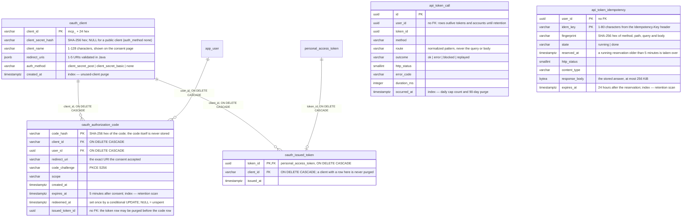
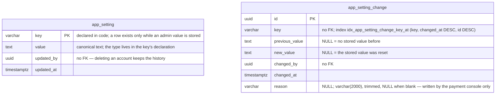
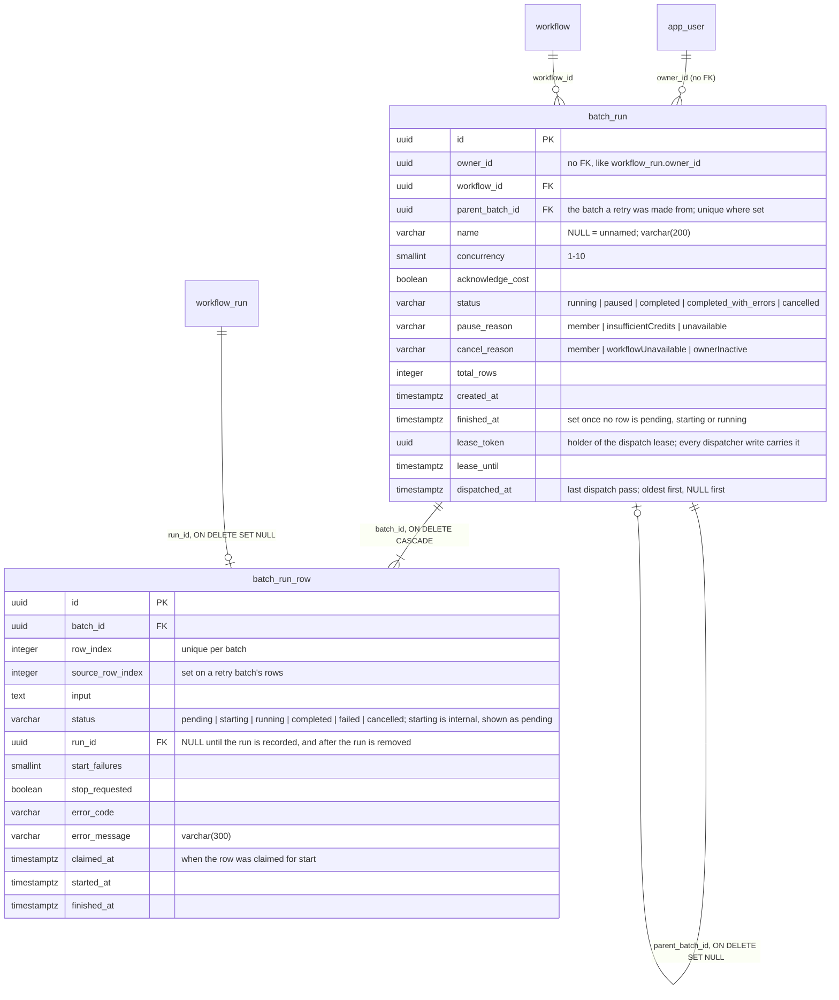
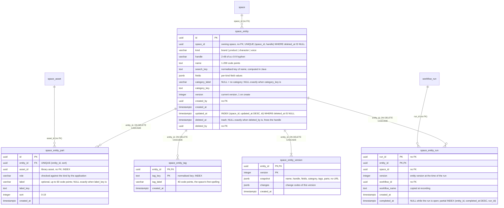
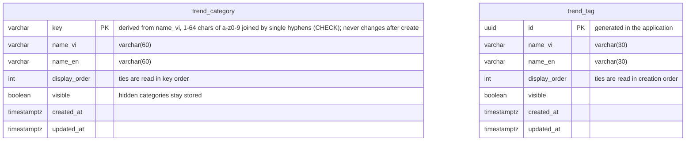

# Entity–Relationship Diagram — Flow-Cortex

Source of truth for the schema is the Flyway migration set under
`backend/boot/app/src/main/resources/db/migration/` (ADR-0004: migration-first,
Hibernate `ddl-auto: validate`). This diagram mirrors those files and is updated
in the same PR as any migration that changes it. Column notes list only what a
reader cannot infer from the name.

## Current schema (`V2026.09.22.001` – `V2026.11.11.280`)

```mermaid
erDiagram
  app_user ||--o{ workflow : "owner_id (no FK)"
  app_user ||--o{ workflow_run : "owner_id (no FK)"
  app_user ||--o{ step_up_proof : "user_id, ON DELETE CASCADE"
  app_user ||--o{ personal_access_token : "user_id, ON DELETE CASCADE"
  workflow ||--|{ workflow_step : "workflow_id"
  workflow ||--o{ workflow_run : "workflow_id"
  workflow_run ||--|{ run_step : "run_id"
  workflow_run ||--o{ media_asset_binding : "run_id"
  workflow_run ||--o| product_video_input : "run_id"
  workflow_run ||--o{ review_task : "run_id"
  run_step ||--o| review_task : "run_step_id, UNIQUE — one checkpoint per step"
  review_task ||--o{ script_revision : "review_task_id"
  media_asset ||--o{ media_asset_binding : "asset_id"
  workflow ||--o{ workflow_bookmark : "workflow_id"
  workflow ||--o{ workflow_review : "workflow_id"
  workflow_review ||--o{ workflow_review_image : "review_id, ON DELETE CASCADE"
  workflow_review ||--o{ workflow_review_helpful : "review_id, ON DELETE CASCADE"
  workflow_review ||--o{ workflow_review_report : "review_id, ON DELETE CASCADE"
  media_asset ||--o| space_asset : "media_asset_id, UNIQUE (no FK)"
  space_asset ||--o{ space_asset_tag : "asset_id, ON DELETE CASCADE"

  app_user {
    uuid id PK
    uuid owner_id "administering ADMIN; an ADMIN is self-owned"
    varchar email UK "global uniqueness — login has no scope input"
    varchar password_hash
    varchar name
    varchar role "ADMIN | MEMBER"
    varchar status "ACTIVE | SUSPENDED"
    timestamptz username_changed_at "NULL until the first username change; the 30-day cooldown reads it"
    timestamptz created_at
    timestamptz updated_at
  }
  workflow {
    uuid id PK
    uuid owner_id
    varchar name
    boolean is_shared "true = listed to every authenticated user"
    timestamptz created_at
    timestamptz updated_at
  }
  workflow_step {
    uuid id PK
    uuid workflow_id FK
    smallint step_order "UNIQUE (workflow_id, step_order), contiguous from 1"
    varchar name
    varchar type "inline, provider remote, media remote, APPROVAL_CHECKPOINT or qa.review"
    jsonb config
    varchar input_ref "{step:K.field}; NULL = previous step's output"
  }
  workflow_run {
    uuid id PK
    uuid workflow_id FK
    uuid owner_id "runs are always owner-scoped, even for shared workflows"
    varchar status "running | completed | error"
    text input
    text error_message
    timestamptz started_at
    timestamptz finished_at
    timestamptz last_swept_at "reaper's stalled-run sweep; NULL = never (NULLS FIRST)"
  }
  run_step {
    uuid id PK
    uuid run_id FK
    smallint step_order "UNIQUE (run_id, step_order)"
    varchar type
    jsonb config "copied from workflow_step when the run starts; dispatch reads only this copy"
    varchar input_ref "copied from workflow_step when the run starts"
    varchar status "pending | running | completed | error — claim = UPDATE ... WHERE status = 'pending'"
    text input "resolved input"
    text output
    text error_message
    timestamptz started_at "claim time"
    timestamptz finished_at
    timestamptz queue_deadline "set at claim — unpicked past it = queue_timeout"
    timestamptz picked_up_at "first pickup; NULL = still queued"
    timestamptz lease_until "extended by each heartbeat — lapsed = lease_expired"
    timestamptz run_deadline "set by each delivery's started — passed = run_timeout"
    smallint progress_percent "CHECK 0–100"
    smallint attempt "DEFAULT 1; API-owned fencing token every result CAS checks, constant 1 here"
    smallint delivery_count "DEFAULT 0; broker redeliveries, display only"
    varchar error_code "queue_timeout | lease_expired | run_timeout | media_disabled | input_rejected | probe_failed | contract_violation | speech_too_long | workflow_changed"
    jsonb outputs "MediaOutput[] {name, bucket, objectKey, mime, bytes, meta} — object keys runs/{runId}/steps/{order}/{name}"
  }
  media_asset {
    uuid id PK "upload id for uploaded inputs"
    uuid owner_id "application-enforced owner scope"
    uuid space_id "personal space of the owner, NOT NULL, no FK"
    varchar kind "image | audio | video | binary"
    varchar bucket
    varchar object_key UK
    varchar mime_type
    bigint bytes
    varchar checksum "object-store SHA-256 when available"
    varchar status "ready"
    timestamptz expires_at "NULL until a retention policy is assigned"
    uuid source_run_step_id "output provenance; NULL for uploads"
    smallint source_attempt "attempt fence; NULL for uploads"
    timestamptz created_at
  }
  media_asset_binding {
    uuid run_id PK,FK
    varchar binding_key PK "image_1 .. image_10"
    uuid asset_id FK
    smallint position "UNIQUE (run_id, position), preserves request order"
    timestamptz created_at
  }
  space_asset {
    uuid id PK
    uuid space_id "owning space, no FK"
    uuid owner_id "no FK"
    uuid media_asset_id UK "the stored file; an upload asset points at the run's copy, no FK"
    varchar source "run | upload"
    varchar kind "video | image | audio"
    text title "1-200 code points"
    text title_base "run titles: the name before the (N) and index suffixes"
    integer title_version "N of the (N) suffix, 1 = none"
    varchar bucket "UNIQUE with object_key"
    varchar object_key
    varchar mime_type
    bigint bytes
    uuid run_id "producing run, or the run that bound the upload"
    uuid run_step_id "NOT NULL exactly when source = run"
    uuid workflow_id
    text workflow_name "copied at registration"
    timestamptz created_at "index (space_id, created_at DESC, id DESC) serves the newest-first walk"
    boolean favorite "default false"
    timestamptz missing_at "set by a link route when the stored file is gone, NULL otherwise"
    text title_search "generated: asset_search_fold(title), accents/case/d-stroke folded"
  }
  space_asset_tag {
    uuid asset_id PK,FK "ON DELETE CASCADE"
    uuid space_id "copied for the per-space tag list, no FK"
    text label "1-40 characters, first label kept per tag_key"
    text tag_key PK "generated: asset_search_fold(label)"
    timestamptz created_at
  }
  space_asset_registration {
    uuid id PK
    varchar source_type "run_outputs | run_inputs, UNIQUE with source_id"
    uuid source_id "run id"
    uuid owner_id
    varchar status "pending | done | skipped | stuck"
    integer attempts "stuck at 288"
    varchar last_error_code
    timestamptz next_attempt_at "partial index WHERE status = pending"
    timestamptz lease_until "5 minutes from claim"
    uuid lease_token "fences finish and retry"
    timestamptz created_at
    timestamptz updated_at "finished rows deleted after 30 days"
  }
  trash_entry {
    uuid id PK
    varchar item_type "lowercase key, UNIQUE with item_id; the owning module's provider type"
    varchar item_id "the trashed row's id in its own module, no FK"
    uuid owner_id "the account that sees and acts on the entry, no FK"
    uuid deleted_by "no FK"
    text name "1-200 characters; NULL = untitled"
    text name_key "folded search key written by Java; empty when untitled"
    varchar location_code "message code of where the item lived"
    timestamptz deleted_at "expiry = deleted_at + retention, never stored"
    timestamptz reminded_at "NULL until the expiry reminder claims it; cleared when the item is deleted again"
  }
  product_video_input {
    uuid run_id PK,FK
    varchar product_name
    varchar description
    varchar cta
    varchar price "optional confirmed claim"
    varchar promotion "optional confirmed claim"
    varchar aspect_ratio "9:16 in MVP"
    timestamptz created_at
  }
  review_task {
    uuid id PK
    uuid run_id FK "ON DELETE CASCADE"
    uuid run_step_id FK,UK "ON DELETE CASCADE — a step pauses at most once"
    varchar review_type "APPROVAL_CHECKPOINT | QA_REVIEW"
    varchar status "pending | approved | rejected | expired"
    text original_payload "the checkpoint's input, unwrapped from the provider result"
    text reviewed_payload "plain checkpoints only; a script task approves a revision instead"
    uuid reviewed_by
    timestamptz reviewed_at
    timestamptz created_at
    bigint version "JPA @Version — the decision's optimistic lock"
    uuid current_revision_id FK "the revision on screen; NULL = task keeps no revisions"
    uuid approved_revision_id FK "the revision that was approved; NULL until a decision"
    timestamptz expires_at "time limit; a pending task past it is ended expired by the sweep"
    jsonb questions "QA_REVIEW only: the questions shown"
    text questions_state "generating | ready; NOT NULL exactly when review_type = QA_REVIEW"
    jsonb answers "QA_REVIEW only: the answers given"
    text decision_key "Idempotency-Key of the decision that ended the task, 1-80 chars"
  }
  script_revision {
    uuid id PK
    uuid run_id FK "ON DELETE CASCADE"
    uuid review_task_id FK "ON DELETE CASCADE"
    integer revision_number "UNIQUE (review_task_id, revision_number), CHECK > 0"
    text content "CHECK length(btrim(content)) > 0 — revisions are never blank"
    uuid created_by "NULL for revision 1, which the provider wrote"
    timestamptz created_at
  }
  step_up_proof {
    uuid id PK
    uuid user_id FK "ON DELETE CASCADE"
    varchar purpose "closed list in code (StepUpPurpose), no CHECK"
    varchar token_hash UK "SHA-256 hex of the proof; the proof itself is never stored"
    timestamptz created_at
    timestamptz expires_at "index — retention scan"
    timestamptz consumed_at "set once by a conditional UPDATE; NULL = unspent"
  }
  personal_access_token {
    uuid id PK
    uuid user_id FK "ON DELETE CASCADE"
    varchar name "1-128 characters, chosen by the owner"
    varchar token_hash UK "SHA-256 hex of the fc_pat_ token; the token itself is never stored"
    timestamptz created_at
    timestamptz expires_at "1-365 days after creation"
    timestamptz last_used_at "NULL until first use; written at most once a minute"
    timestamptz revoked_at "NULL = not revoked; soft, the retention job deletes the row"
  }
  workflow_bookmark {
    uuid user_id PK "no FK — the user table belongs to another module"
    uuid workflow_id PK,FK
    timestamptz created_at "kept when the workflow leaves the member's sight, so it returns with its date"
  }
  workflow_review {
    uuid id PK
    uuid workflow_id FK "UNIQUE (workflow_id, user_id) — one review per member"
    uuid user_id "no FK"
    smallint rating "CHECK 1..5"
    varchar body "up to 5000, NULL when blank"
    integer helpful_count "CHECK >= 0; moved only by additive updates beside a mark insert or delete"
    timestamptz created_at
    timestamptz updated_at
  }
  workflow_review_image {
    uuid id PK
    uuid review_id FK
    smallint position "1..5, UNIQUE (review_id, position) DEFERRABLE INITIALLY DEFERRED"
    varchar bucket
    varchar object_key "workflow-review/<workflowId>/<userId>/<batch>/..."
    varchar content_type
    bigint size_bytes
    timestamptz created_at
  }
  workflow_review_helpful {
    uuid review_id PK,FK
    uuid user_id PK "no FK"
    timestamptz created_at
  }
  workflow_review_report {
    uuid review_id PK,FK
    uuid reporter_id PK "no FK; one report per reporter"
    varchar reason "spam | scam | harmful | harassment | misinformation | copyright | nsfw | other"
    varchar details "up to 1000"
    timestamptz created_at
  }
  event_publication {
    uuid id PK "Spring Modulith event publication registry (transactional outbox)"
    text listener_id
    text event_type
    text serialized_event "hash index — idempotency lookup"
    timestamptz publication_date
    timestamptz completion_date "index — recovery query on restart"
    text status
    integer completion_attempts
    timestamptz last_resubmission_date
  }
  drive_item {
    uuid id PK
    uuid space_id "personal space of the owner, no FK; INDEX (space_id, created_at DESC, id DESC)"
    uuid owner_id "no FK"
    varchar name "1-160 chars, sent by the client"
    varchar content_type "text | image | video | audio"
    varchar semantic_role "role vocabulary checked by the application"
    text text_value "text items only"
    varchar source "text | upload | run_output — CHECK ck_drive_item_payload ties source to the columns that must be set or empty"
    varchar bucket "media items"
    varchar object_key "upload: drive/{spaceId}/{itemId}; run_output: the run's own output key"
    varchar file_name
    varchar mime_type
    bigint size_bytes
    uuid run_id "run_output only, no FK"
    smallint step_order "run_output only"
    timestamptz created_at
    timestamptz updated_at
  }
  memory_result {
    uuid id PK
    uuid space_id "UNIQUE (space_id, result_key)"
    uuid owner_id "no FK"
    uuid run_id "INDEX; no FK"
    uuid run_step_id "no FK"
    smallint step_order
    varchar result_key "run_step_id for text, run_step_id/outputName for media — stable across attempts"
    varchar kind "text | image | video | audio"
    varchar title
    varchar preview_text "text results, first 500 chars"
    varchar bucket "media results"
    varchar object_key "media results"
    varchar file_name
    varchar mime_type
    bigint size_bytes "text: UTF-8 byte length"
    timestamptz result_at "run finished_at"
    boolean pinned "member-owned, survives re-population"
    boolean hidden "member-owned, survives re-population"
    timestamptz created_at
    timestamptz updated_at
  }
  drive_backfill {
    uuid space_id PK
    uuid owner_id
    timestamptz migrated_at "NULL until an apply inserted an entry for the space"
    jsonb counts "{runs, results} inserted by applies"
    timestamptz reconciled_at
    boolean ok
    timestamptz updated_at
  }
```

Indexes: `idx_app_user_owner_id`, `idx_workflow_owner_id`, `idx_workflow_run_owner_id`,
`idx_workflow_run_workflow_id`, `idx_workflow_run_started_at` (`started_at DESC, id DESC` — the admin Runs
list, newest first), `idx_run_step_run_id`, `idx_run_step_running` (partial, `WHERE status = 'running'` —
the reaper scan), `idx_review_task_run_id`, `idx_review_task_pending_expiry` (partial, `WHERE status = 'pending'` — the
expiry sweep), `idx_script_revision_run`,
`idx_step_up_proof_expires_at`, `idx_pat_user_live` (partial, `WHERE revoked_at IS NULL`), `idx_event_publication_serialized_event` (hash),
`idx_event_publication_completion_date`,
`idx_workflow_bookmark_page` (`user_id, created_at DESC, workflow_id DESC` — the saved list),
`idx_workflow_review_newest` (`workflow_id, created_at DESC, id DESC`), `idx_workflow_review_helpful`
(`workflow_id, helpful_count DESC, created_at DESC, id DESC`).

`owner_id` columns carry no foreign key on purpose: the user module owns `app_user`, the workflow module
owns the other tables, and the module boundary (ADR-0003) is kept at the schema level too — ownership is
enforced in the application, not by a cross-module constraint.

`run_step` *is* the media job: its `id` is the `jobId` on the broker, so no separate job table exists, and
no upload table either — an upload is an object at a server-derived key. `input_rejected` = the uploaded
object was missing or over size when the worker checked it. Objects never live in the database: uploads in
the bucket `flowcortex-uploads`, the objects `outputs` references in `flowcortex-media`.

`script_revision` is append-only: an edit inserts a row and moves `review_task.current_revision_id`
forward, never overwrites one. Approval names a revision id and the task `version` it read, so a browser
tab holding older text loses the approval with a 409 instead of approving something it never showed. The
payload `generate_speech` consumes is the approved revision's content, not whatever sits in the task.

## Profile settings and images (`V2026.11.11.090` – `V2026.11.11.091`)

Indexes: `uq_profile_image_current` (unique, partial `WHERE role = 'current'` — one shown image per member
and slot, which also makes concurrent saves exactly-once), `idx_profile_image_history` (partial
`WHERE role = 'original'`, newest first).

`username_hold` and `account_preference` live in the user module and cascade with `app_user`.
`profile_image` belongs to the profile module and carries no foreign key to `app_user`, like the other
cross-module tables: the module boundary is kept at the schema level, and a deleted account leaves its
rows behind.

## MCP authorization server and token call guards (`V2026.11.15.225` – `V2026.11.15.226`)

Indexes: `idx_oauth_client_created_at`, `idx_oauth_code_expires_at`, `idx_oauth_issued_token_client`,
`idx_api_token_call_user_time` (`user_id, occurred_at`), `idx_api_token_call_occurred_at`,
`idx_api_token_idempotency_expires_at`.

`api_token_call` and `api_token_idempotency` carry no foreign key on purpose: the audit trail and the
stored answers outlive the token and the account until the retention job deletes them.
`user.mcp-oauth-retention` deletes spent codes, unused clients, old call rows and ended reservations.

## Runtime settings (`V2026.11.11.180`, `V2026.11.11.320`)

`app_setting_change` is append-only history; one row is committed in the transaction that stores or resets
the value, and a write of the value already stored records none.

## Batch runs (`V2026.11.26.505`)

Indexes: `idx_batch_run_owner_created` (`owner_id, created_at DESC, id DESC` — the member's list),
`idx_batch_run_open` (partial `WHERE finished_at IS NULL`, `dispatched_at NULLS FIRST` — the dispatcher's
candidates), `uq_batch_run_parent` (unique, partial `WHERE parent_batch_id IS NOT NULL` — one retry per batch),
`idx_batch_run_row_open` (partial `WHERE status IN ('pending','starting','running')`, `batch_id, row_index`),
`idx_batch_run_row_status` (`batch_id, status, row_index` — the grouped counts and the row list).

Row counts are not stored on `batch_run`; they are one grouped read over `idx_batch_run_row_status`.

## Two-factor sign-in (`V2026.11.26.610`)

```mermaid
erDiagram
  app_user ||--o| user_totp : "user_id, ON DELETE CASCADE"
  app_user ||--o{ user_recovery_code : "user_id, ON DELETE CASCADE"
  app_user ||--o{ login_challenge : "user_id, ON DELETE CASCADE"
  app_user ||--o{ refresh_token : "user_id, ON DELETE CASCADE"

  user_totp {
    uuid user_id PK, FK
    text secret_encrypted "AES-256-GCM, kid.iv.tag.ct, bound to the account id"
    timestamptz enabled_at "NULL = setup pending, not yet confirmed with a code"
    bigint last_used_step "highest accepted 30 s step; moved forward by a conditional UPDATE, so a code is accepted once"
    integer failed_attempts "CHECK >= 0; back to 0 when the account locks or a code is accepted"
    timestamptz locked_until "NULL = not locked"
    timestamptz created_at
    timestamptz updated_at
  }
  user_recovery_code {
    uuid id PK
    uuid user_id FK "ON DELETE CASCADE"
    varchar key_id "keyring id the hash was made under"
    char code_hash "UNIQUE (user_id, key_id, code_hash); hex HMAC-SHA256 of the normalized code"
    timestamptz created_at
  }
  login_challenge {
    uuid id PK
    uuid user_id FK "ON DELETE CASCADE; index idx_login_challenge_user"
    char token_hash UK "SHA-256 hex of the cookie value; the value itself is never stored"
    boolean remember_me "carried to the session the completed challenge opens"
    varchar origin "password | google | link, CHECK"
    integer failed_codes "CHECK >= 0; the limit is configuration, enforced in the statement"
    timestamptz expires_at "index idx_login_challenge_expires — retention scan"
    timestamptz spent_at "set once by a conditional UPDATE; NULL = unspent"
    timestamptz created_at
  }
  refresh_token {
    uuid id PK
    uuid user_id FK "ON DELETE CASCADE"
    uuid family_id "one family = one session"
    timestamptz mfa_verified_at "NULL = the session never passed the second factor; copied to every rotation"
  }
```

`refresh_token` shows only the columns this section touches; the rest are in `V2026.10.14.002`.

A recovery code is spent by deleting its row, so nothing reads a used code and no purge exists. A pending
setup is the one `user_totp` row of the account with `enabled_at` NULL, replaced in place by a new setup
without clearing `failed_attempts` and `locked_until`, so starting over does not lift a lock. Live
challenges of an account are deleted with its disable and reset; the auth retention job deletes the dead
ones.

## Space entities (`V2026.11.26.501`)

An entity is trashed by stamping `deleted_at`/`deleted_by`, never deleted; the partial unique index on
`handle` only covers live rows, so a trashed entity's handle is free again. `ON DELETE CASCADE` matters only
for a future purge.

## Trend taxonomy (`V2026.11.15.260`)

No relations yet: the template table and its category foreign key arrive with the template change. The
migration seeds four categories (`nguoi`, `san-pham`, `thu-cung`, `nhay-chuyen-canh`) and the two
`content.trend_template.*` permission keys.

## Roadmap tables (each arrives with its own change)

| Table | Purpose | Arrives with |
|---|---|---|
| `provider` | provider catalogue + fallback order per capability | Providers page / first real capability |
| `usage_event` | per-step provider units and cost | first paid provider |
| `audit_log` | admin actions with before/after | first admin write beyond Users |
| `channel_account` | publish targets with encrypted tokens | Publish step |
