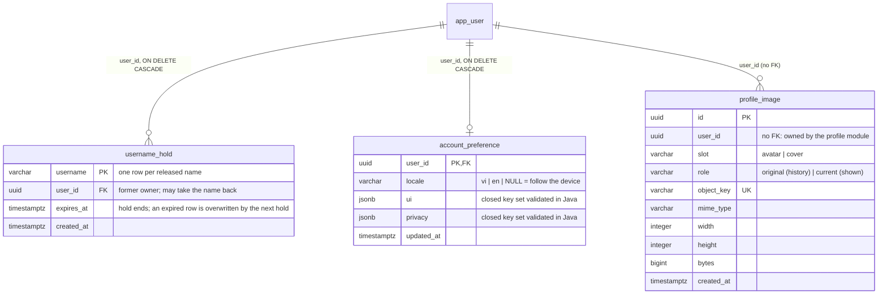
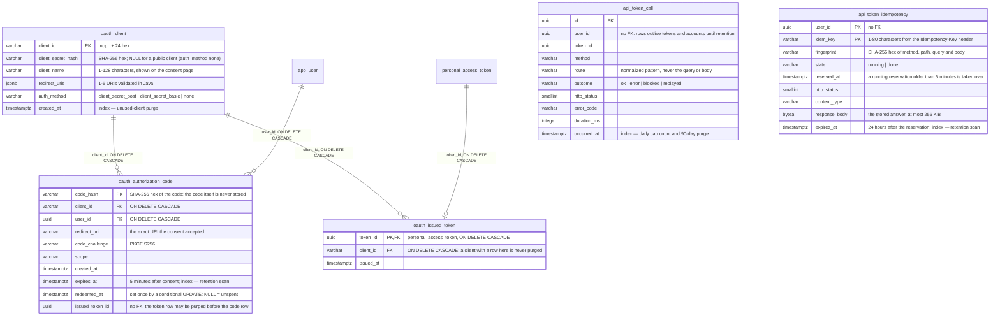
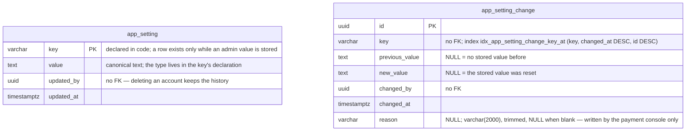

# Sơ đồ thực thể và quan hệ — Flow-Cortex

Đối chiếu schema với [các migration Flyway](../backend/boot/app/src/main/resources/db/migration) theo ADR-0004. Hibernate dùng `ddl-auto: validate`. Cập nhật sơ đồ trong cùng PR khi migration thay đổi schema được mô tả. Chú thích cột bổ sung ý nghĩa và ràng buộc cần thiết.

## Sơ đồ tổng quan

Sơ đồ nhóm các bảng tài khoản, workflow và dữ liệu hỗ trợ được trình bày chung. Các phần hồ sơ, MCP OAuth và cấu hình runtime có sơ đồ riêng bên dưới. Phạm vi của mỗi sơ đồ được xác định bởi các bảng được liệt kê.

```mermaid
erDiagram
  app_user ||--o{ workflow : "owner_id (no FK)"
  app_user ||--o{ workflow_run : "owner_id (no FK)"
  app_user ||--o{ step_up_proof : "user_id, ON DELETE CASCADE"
  app_user ||--o{ personal_access_token : "user_id, ON DELETE CASCADE"
  workflow ||--|{ workflow_step : "workflow_id"
  workflow ||--o{ workflow_run : "workflow_id"
  workflow_run ||--|{ run_step : "run_id"
  workflow_run ||--o{ media_asset_binding : "run_id"
  workflow_run ||--o| product_video_input : "run_id"
  workflow_run ||--o{ review_task : "run_id"
  run_step ||--o| review_task : "run_step_id, UNIQUE — one checkpoint per step"
  review_task ||--o{ script_revision : "review_task_id"
  media_asset ||--o{ media_asset_binding : "asset_id"
  workflow ||--o{ workflow_bookmark : "workflow_id"
  workflow ||--o{ workflow_review : "workflow_id"
  workflow_review ||--o{ workflow_review_image : "review_id, ON DELETE CASCADE"
  workflow_review ||--o{ workflow_review_helpful : "review_id, ON DELETE CASCADE"
  workflow_review ||--o{ workflow_review_report : "review_id, ON DELETE CASCADE"
  media_asset ||--o| space_asset : "media_asset_id, UNIQUE (no FK)"

  app_user {
    uuid id PK
    uuid owner_id "administering ADMIN; an ADMIN is self-owned"
    varchar email UK "global uniqueness — login has no scope input"
    varchar password_hash
    varchar name
    varchar role "ADMIN | MEMBER"
    varchar status "ACTIVE | SUSPENDED"
    timestamptz username_changed_at "NULL until the first username change; the 30-day cooldown reads it"
    timestamptz created_at
    timestamptz updated_at
  }
  workflow {
    uuid id PK
    uuid owner_id
    varchar name
    boolean is_shared "true = listed to every authenticated user"
    timestamptz created_at
    timestamptz updated_at
  }
  workflow_step {
    uuid id PK
    uuid workflow_id FK
    smallint step_order "UNIQUE (workflow_id, step_order), contiguous from 1"
    varchar name
    varchar type "inline, provider remote, media remote, APPROVAL_CHECKPOINT or qa.review"
    jsonb config
    varchar input_ref "{step:K.field}; NULL = previous step's output"
  }
  workflow_run {
    uuid id PK
    uuid workflow_id FK
    uuid owner_id "runs are always owner-scoped, even for shared workflows"
    varchar status "running | completed | error"
    text input
    text error_message
    timestamptz started_at
    timestamptz finished_at
    timestamptz last_swept_at "reaper's stalled-run sweep; NULL = never (NULLS FIRST)"
  }
  run_step {
    uuid id PK
    uuid run_id FK
    smallint step_order "UNIQUE (run_id, step_order)"
    varchar type
    jsonb config "copied from workflow_step when the run starts; dispatch reads only this copy"
    varchar input_ref "copied from workflow_step when the run starts"
    varchar status "pending | running | completed | error — claim = UPDATE ... WHERE status = 'pending'"
    text input "resolved input"
    text output
    text error_message
    timestamptz started_at "claim time"
    timestamptz finished_at
    timestamptz queue_deadline "set at claim — unpicked past it = queue_timeout"
    timestamptz picked_up_at "first pickup; NULL = still queued"
    timestamptz lease_until "extended by each heartbeat — lapsed = lease_expired"
    timestamptz run_deadline "set by each delivery's started — passed = run_timeout"
    smallint progress_percent "CHECK 0–100"
    smallint attempt "DEFAULT 1; API-owned fencing token every result CAS checks, constant 1 here"
    smallint delivery_count "DEFAULT 0; broker redeliveries, display only"
    varchar error_code "queue_timeout | lease_expired | run_timeout | media_disabled | input_rejected | probe_failed | contract_violation | speech_too_long | workflow_changed"
    jsonb outputs "MediaOutput[] {name, bucket, objectKey, mime, bytes, meta} — object keys runs/{runId}/steps/{order}/{name}"
  }
  media_asset {
    uuid id PK "upload id for uploaded inputs"
    uuid owner_id "application-enforced owner scope"
    uuid space_id "personal space of the owner, NOT NULL, no FK"
    varchar kind "image | audio | video | binary"
    varchar bucket
    varchar object_key UK
    varchar mime_type
    bigint bytes
    varchar checksum "object-store SHA-256 when available"
    varchar status "ready"
    timestamptz expires_at "NULL until a retention policy is assigned"
    uuid source_run_step_id "output provenance; NULL for uploads"
    smallint source_attempt "attempt fence; NULL for uploads"
    timestamptz created_at
  }
  media_asset_binding {
    uuid run_id PK,FK
    varchar binding_key PK "image_1 .. image_10"
    uuid asset_id FK
    smallint position "UNIQUE (run_id, position), preserves request order"
    timestamptz created_at
  }
  space_asset {
    uuid id PK
    uuid space_id "owning space, no FK"
    uuid owner_id "no FK"
    uuid media_asset_id UK "the stored file; an upload asset points at the run's copy, no FK"
    varchar source "run | upload"
    varchar kind "video | image | audio"
    text title "1-200 code points"
    text title_base "run titles: the name before the (N) and index suffixes"
    integer title_version "N of the (N) suffix, 1 = none"
    varchar bucket "UNIQUE with object_key"
    varchar object_key
    varchar mime_type
    bigint bytes
    uuid run_id "producing run, or the run that bound the upload"
    uuid run_step_id "NOT NULL exactly when source = run"
    uuid workflow_id
    text workflow_name "copied at registration"
    timestamptz created_at
  }
  space_asset_registration {
    uuid id PK
    varchar source_type "run_outputs | run_inputs, UNIQUE with source_id"
    uuid source_id "run id"
    uuid owner_id
    varchar status "pending | done | skipped | stuck"
    integer attempts "stuck at 288"
    varchar last_error_code
    timestamptz next_attempt_at "partial index WHERE status = pending"
    timestamptz lease_until "5 minutes from claim"
    uuid lease_token "fences finish and retry"
    timestamptz created_at
    timestamptz updated_at "finished rows deleted after 30 days"
  }
  product_video_input {
    uuid run_id PK,FK
    varchar product_name
    varchar description
    varchar cta
    varchar price "optional confirmed claim"
    varchar promotion "optional confirmed claim"
    varchar aspect_ratio "9:16 in MVP"
    timestamptz created_at
  }
  review_task {
    uuid id PK
    uuid run_id FK "ON DELETE CASCADE"
    uuid run_step_id FK,UK "ON DELETE CASCADE — a step pauses at most once"
    varchar review_type "APPROVAL_CHECKPOINT | QA_REVIEW"
    varchar status "pending | approved | rejected | expired"
    text original_payload "the checkpoint's input, unwrapped from the provider result"
    text reviewed_payload "plain checkpoints only; a script task approves a revision instead"
    uuid reviewed_by
    timestamptz reviewed_at
    timestamptz created_at
    bigint version "JPA @Version — the decision's optimistic lock"
    uuid current_revision_id FK "the revision on screen; NULL = task keeps no revisions"
    uuid approved_revision_id FK "the revision that was approved; NULL until a decision"
    timestamptz expires_at "time limit; a pending task past it is ended expired by the sweep"
    jsonb questions "QA_REVIEW only: the questions shown"
    text questions_state "generating | ready; NOT NULL exactly when review_type = QA_REVIEW"
    jsonb answers "QA_REVIEW only: the answers given"
    text decision_key "Idempotency-Key of the decision that ended the task, 1-80 chars"
  }
  script_revision {
    uuid id PK
    uuid run_id FK "ON DELETE CASCADE"
    uuid review_task_id FK "ON DELETE CASCADE"
    integer revision_number "UNIQUE (review_task_id, revision_number), CHECK > 0"
    text content "CHECK length(btrim(content)) > 0 — revisions are never blank"
    uuid created_by "NULL for revision 1, which the provider wrote"
    timestamptz created_at
  }
  step_up_proof {
    uuid id PK
    uuid user_id FK "ON DELETE CASCADE"
    varchar purpose "closed list in code (StepUpPurpose), no CHECK"
    varchar token_hash UK "SHA-256 hex of the proof; the proof itself is never stored"
    timestamptz created_at
    timestamptz expires_at "index — retention scan"
    timestamptz consumed_at "set once by a conditional UPDATE; NULL = unspent"
  }
  personal_access_token {
    uuid id PK
    uuid user_id FK "ON DELETE CASCADE"
    varchar name "1-128 characters, chosen by the owner"
    varchar token_hash UK "SHA-256 hex of the fc_pat_ token; the token itself is never stored"
    timestamptz created_at
    timestamptz expires_at "1-365 days after creation"
    timestamptz last_used_at "NULL until first use; written at most once a minute"
    timestamptz revoked_at "NULL = not revoked; soft, the retention job deletes the row"
  }
  workflow_bookmark {
    uuid user_id PK "no FK — the user table belongs to another module"
    uuid workflow_id PK,FK
    timestamptz created_at "kept when the workflow leaves the member's sight, so it returns with its date"
  }
  workflow_review {
    uuid id PK
    uuid workflow_id FK "UNIQUE (workflow_id, user_id) — one review per member"
    uuid user_id "no FK"
    smallint rating "CHECK 1..5"
    varchar body "up to 5000, NULL when blank"
    integer helpful_count "CHECK >= 0; moved only by additive updates beside a mark insert or delete"
    timestamptz created_at
    timestamptz updated_at
  }
  workflow_review_image {
    uuid id PK
    uuid review_id FK
    smallint position "1..5, UNIQUE (review_id, position) DEFERRABLE INITIALLY DEFERRED"
    varchar bucket
    varchar object_key "workflow-review/<workflowId>/<userId>/<batch>/..."
    varchar content_type
    bigint size_bytes
    timestamptz created_at
  }
  workflow_review_helpful {
    uuid review_id PK,FK
    uuid user_id PK "no FK"
    timestamptz created_at
  }
  workflow_review_report {
    uuid review_id PK,FK
    uuid reporter_id PK "no FK; one report per reporter"
    varchar reason "spam | scam | harmful | harassment | misinformation | copyright | nsfw | other"
    varchar details "up to 1000"
    timestamptz created_at
  }
  event_publication {
    uuid id PK "Spring Modulith event publication registry (transactional outbox)"
    text listener_id
    text event_type
    text serialized_event "hash index — idempotency lookup"
    timestamptz publication_date
    timestamptz completion_date "index — recovery query on restart"
    text status
    integer completion_attempts
    timestamptz last_resubmission_date
  }
  drive_item {
    uuid id PK
    uuid space_id "personal space of the owner, no FK; INDEX (space_id, created_at DESC, id DESC)"
    uuid owner_id "no FK"
    varchar name "1-160 chars, sent by the client"
    varchar content_type "text | image | video | audio"
    varchar semantic_role "role vocabulary checked by the application"
    text text_value "text items only"
    varchar source "text | upload | run_output — CHECK ck_drive_item_payload ties source to the columns that must be set or empty"
    varchar bucket "media items"
    varchar object_key "upload: drive/{spaceId}/{itemId}; run_output: the run's own output key"
    varchar file_name
    varchar mime_type
    bigint size_bytes
    uuid run_id "run_output only, no FK"
    smallint step_order "run_output only"
    timestamptz created_at
    timestamptz updated_at
  }
  memory_result {
    uuid id PK
    uuid space_id "UNIQUE (space_id, result_key)"
    uuid owner_id "no FK"
    uuid run_id "INDEX; no FK"
    uuid run_step_id "no FK"
    smallint step_order
    varchar result_key "run_step_id for text, run_step_id/outputName for media — stable across attempts"
    varchar kind "text | image | video | audio"
    varchar title
    varchar preview_text "text results, first 500 chars"
    varchar bucket "media results"
    varchar object_key "media results"
    varchar file_name
    varchar mime_type
    bigint size_bytes "text: UTF-8 byte length"
    timestamptz result_at "run finished_at"
    boolean pinned "member-owned, survives re-population"
    boolean hidden "member-owned, survives re-population"
    timestamptz created_at
    timestamptz updated_at
  }
  drive_backfill {
    uuid space_id PK
    uuid owner_id
    timestamptz migrated_at "NULL until an apply inserted an entry for the space"
    jsonb counts "{runs, results} inserted by applies"
    timestamptz reconciled_at
    boolean ok
    timestamptz updated_at
  }
```

Các chỉ mục gồm `idx_app_user_owner_id`, `idx_workflow_owner_id`, `idx_workflow_run_owner_id`,
`idx_workflow_run_workflow_id`, `idx_workflow_run_started_at` (`started_at DESC, id DESC` cho danh sách lượt chạy phía admin),
`idx_run_step_run_id`, `idx_run_step_running` (chỉ các hàng có `status = 'running'` để quét bước chạy),
`idx_review_task_run_id`, `idx_review_task_pending_expiry` (chỉ các hàng có `status = 'pending'` để quét tác vụ hết hạn),
`idx_script_revision_run`, `idx_step_up_proof_expires_at`, `idx_pat_user_live` (chỉ các hàng có `revoked_at IS NULL`), `idx_event_publication_serialized_event` (hash),
`idx_event_publication_completion_date`,
`idx_workflow_bookmark_page` (`user_id, created_at DESC, workflow_id DESC` cho danh sách đã lưu),
`idx_workflow_review_newest` (`workflow_id, created_at DESC, id DESC`), `idx_workflow_review_helpful`
(`workflow_id, helpful_count DESC, created_at DESC, id DESC`).

Các cột `owner_id` thể hiện quan hệ sở hữu do ứng dụng kiểm soát. Schema giữ ranh giới mô-đun theo ADR-0003. Mô-đun user sở hữu `app_user`, còn mô-đun workflow sở hữu các bảng liên quan đến workflow.

`run_step.id` được dùng làm `jobId` trên broker. Máy chủ xác định khóa đối tượng tải lên trong bucket `flowcortex-uploads`. Trường `outputs` tham chiếu các đối tượng trong `flowcortex-media`. Worker trả `input_rejected` khi đối tượng tải lên bị thiếu hoặc vượt giới hạn kích thước.

Mỗi lần sửa kịch bản thêm một hàng vào `script_revision` và chuyển `review_task.current_revision_id` sang bản mới. Yêu cầu duyệt gửi mã bản sửa và `version` của tác vụ đã đọc. Phiên bản cũ nhận `409`. Bước `generate_speech` dùng nội dung của bản được duyệt.

## Cấu hình và ảnh hồ sơ (`V2026.11.11.090` – `V2026.11.11.091`)

Chỉ mục duy nhất `uq_profile_image_current` áp dụng khi `role = 'current'`, bảo đảm mỗi thành viên chỉ có một ảnh hiển thị trên mỗi vị trí ngay cả khi lưu đồng thời. Chỉ mục `idx_profile_image_history` sắp ảnh gốc mới nhất trước với điều kiện `role = 'original'`.

`username_hold` và `account_preference` thuộc mô-đun user và được xóa dây chuyền theo `app_user`. `profile_image` thuộc mô-đun profile. Các hàng ảnh được giữ khi xóa tài khoản vì schema giữ ranh giới mô-đun tại quan hệ này.

## Máy chủ ủy quyền MCP và kiểm soát yêu cầu qua token (`V2026.11.15.225` – `V2026.11.15.226`)

Các chỉ mục gồm `idx_oauth_client_created_at`, `idx_oauth_code_expires_at`, `idx_oauth_issued_token_client`,
`idx_api_token_call_user_time` (`user_id, occurred_at`), `idx_api_token_call_occurred_at`,
`idx_api_token_idempotency_expires_at`.

`api_token_call` và `api_token_idempotency` giữ lịch sử và phản hồi đã lưu sau khi xóa token hoặc tài khoản. Job `user.mcp-oauth-retention` xóa mã đã dùng, client không sử dụng, lịch sử yêu cầu cũ và lượt giữ chỗ đã kết thúc.

## Cấu hình runtime (`V2026.11.11.180`, `V2026.11.11.320`)

`app_setting_change` là lịch sử chỉ thêm. Giao dịch lưu hoặc đặt lại giá trị ghi một hàng khi giá trị thay đổi.

## Các bảng dự kiến

| Bảng | Mục đích | Hạng mục triển khai |
|---|---|---|
| `provider` | Danh mục nhà cung cấp và thứ tự dự phòng theo năng lực | Trang nhà cung cấp hoặc năng lực đầu tiên |
| `usage_event` | Mức sử dụng và chi phí nhà cung cấp theo bước | Nhà cung cấp trả phí đầu tiên |
| `audit_log` | Thao tác quản trị và dữ liệu trước/sau | Thao tác ghi đầu tiên ngoài quản lý người dùng |
| `channel_account` | Đích xuất bản và token mã hóa | Bước xuất bản |
