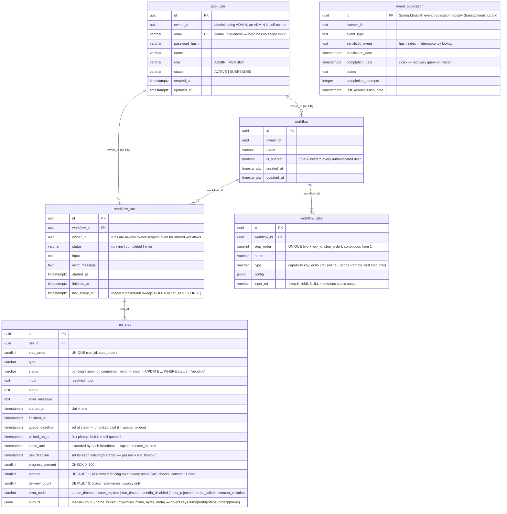

# Entity–Relationship Diagram — Flow-Cortex

Source of truth for the schema is the Flyway migration set under
`backend/boot/app/src/main/resources/db/migration/` (ADR-0004: migration-first,
Hibernate `ddl-auto: validate`). This diagram mirrors those files and is updated
in the same PR as any migration that changes it. Column notes list only what a
reader cannot infer from the name.

## Current schema (`V2026.09.22.001` – `V2026.10.01.002`)

Indexes: `idx_app_user_owner_id`, `idx_workflow_owner_id`, `idx_workflow_run_owner_id`,
`idx_workflow_run_workflow_id`, `idx_workflow_run_started_at` (`started_at DESC, id DESC` — the admin Runs
list, newest first), `idx_run_step_run_id`, `idx_run_step_running` (partial, `WHERE status = 'running'` —
the reaper scan), `idx_event_publication_serialized_event` (hash), `idx_event_publication_completion_date`.

`owner_id` columns carry no foreign key on purpose: the user module owns `app_user`, the workflow module
owns the other tables, and the module boundary (ADR-0003) is kept at the schema level too — ownership is
enforced in the application, not by a cross-module constraint.

`run_step` *is* the media job: its `id` is the `jobId` on the broker, so no separate job table exists, and
no upload table either — an upload is an object at a server-derived key. `input_rejected` = the uploaded
object was missing or over size when the worker checked it. Objects never live in the database: uploads in
the bucket `flowcortex-uploads`, the objects `outputs` references in `flowcortex-media`.

## Roadmap tables (each arrives with its own change)

| Table | Purpose | Arrives with |
|---|---|---|
| `provider` | provider catalogue + fallback order per capability | Providers page / first real capability |
| `media_asset` | first-class assets (sha256, size, expiry) for retention and dedup | first download/demucs capability |
| `usage_event` | per-step provider units and cost | first paid provider |
| `audit_log` | admin actions with before/after | first admin write beyond Users |
| `app_setting`, `settings_audit` | DB-backed runtime settings (override > env > default) | Settings page |
| `channel_account` | publish targets with encrypted tokens | Publish step |
| `run_step.status += awaiting_review` (+ `reviewed_by`, `reviewed_at`) | manual approval checkpoint — a ladder change, not a new table | Review checkpoint change |
