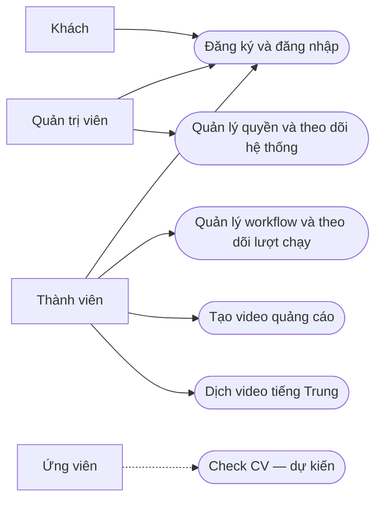

# Phân tích hệ thống

Flow-Cortex giúp người dùng thực thi các quy trình có nhiều bước, theo dõi tiến độ và nhận kết quả. Hai luồng media được mô tả trong đợt này là tạo video quảng cáo từ thông tin sản phẩm và dịch video tiếng Trung. Check CV mở rộng nền tảng sang đánh giá mức độ phù hợp giữa CV và mô tả công việc.

## Tác nhân và use case tổng quát

- [UC-AUTH-01 đến UC-AUTH-04](features/accounts/README.md) — đăng ký, xác minh, đăng nhập, khôi phục và quản lý phiên.
- [UC-PV-01](features/product-video/README.md) — tạo video quảng cáo.
- [UC-VT-01](features/video-translation/README.md) — dịch video tiếng Trung.
- [UC-CV-01](features/check-cv/README.md) — đánh giá CV theo JD, dự kiến.

Điều kiện bắt đầu, kết quả và hành vi khi lỗi nằm trong đặc tả của từng tính năng. Xem [mục lục](README.md) để tra cứu các nhóm hỗ trợ và quản trị.
