# Kế hoạch & Phân tích chuyên sâu (v4): Workflow CheckCV + Huấn luyện mô hình ConFit v2 (ACL 2025) cho BTL NLP trên Flow-Cortex

## 1. Mục tiêu & Toàn bộ 7 Quyết định đã chốt (Goal Description)

Xây dựng hệ thống **CheckCV & Smart Job Recommendation** trên nền tảng **Flow-Cortex**, vừa là một **workflow sản phẩm hoàn chỉnh cho ứng viên**, vừa đáp ứng xuất sắc yêu cầu **Bài tập lớn môn Xử lý Ngôn ngữ Tự nhiên (BTL NLP): triển khai và huấn luyện (train/fine-tune) mô hình theo một bài báo khoa học gần đây (2024–2025)**, đánh giá định lượng bằng Ablation Study và tích hợp **trực tiếp mô hình tự train** vào pipeline suy luận thực tế (không chỉ gọi API LLM thuần).

### Bảng chốt toàn bộ 7 quyết định

| # | Hạng mục | Quyết định đã chốt |
|---|---|---|
| 1 | Đối tượng chính | **Ứng viên (Candidate-First)** |
| 2 | Phạm vi MVP | **1 CV + 1 JD / run** |
| 3 | Xử lý PDF Scan / Canva | **Hybrid 2 tầng** (`PyMuPDF` + fallback **Gemini Vision** trên `provider-worker`) |
| 4 | Bảo mật dữ liệu cá nhân | **Zero-PII-to-LLM mặc định** (khớp `backend/modules/llm/src/main/java/com/flowcortex/llm/api/LlmJsonRequest.java:4-5`) |
| 5 | Phạm vi chỉnh sửa CV | **Trọn bộ `rewrite_cv` + `APPROVAL_CHECKPOINT`** trong MVP |
| 6 | Nạp kho tin tuyển dụng | **Job Ingestion CLI / Import Script** nạp từ bộ dữ liệu đã cào/chuẩn hóa sẵn (200–1000 tin có `source_url` & `expires_at`) |
| 7 | Tích hợp gợi ý việc làm | Bước `recommend_jobs` chạy mặc định cuối workflow CheckCV (**có nút toggle bật/tắt** trên Form khởi chạy) |

---

## 2. Phân tích tính khả thi cho BTL NLP: Train Model theo bài báo gần đây

**Kết luận: RẤT KHẢ THI (đạt 10/10 cả về độ mới học thuật, tính thực tế khi train trên 1 GPU sinh viên, lẫn giá trị tích hợp trực tiếp vào Flow-Cortex).**

### 2.1. Tại sao đề tài này cực kỳ "đắt giá" với giảng viên môn NLP?

- **Không bị lỗi "chỉ là wrapper gọi API LLM":** Tự fine-tune một mô hình Transformer Bi-Encoder theo đúng phương pháp của bài báo **Findings of ACL 2025** với hàm loss Contrastive (`InfoNCE`), kỹ thuật sinh dữ liệu tăng cường **HYRE** và khai thác mẫu âm khó **RUM**, sau đó export sang **ONNX chạy trực tiếp trong Python worker của Flow-Cortex**.
- **Một mô hình tự train giải quyết trực tiếp 2 bài toán lõi trong sản phẩm:**
  1. **Semantic Matching Engine** (tính điểm tương đồng CV–JD phân cấp làm tín hiệu lõi đầu vào cho `CvEvaluationArbiter` và benchmark so sánh trực tiếp với Zero-shot LLM).
  2. **Domain-Adapted Dense Encoder cho Hybrid RAG (`pgvector`)** (thay thế hoàn toàn Gemini Embedding API → **chi phí embedding = \$0**, dữ liệu CV không phải gửi sang dịch vụ embedding ngoài, tốc độ suy luận CPU `< 150 ms`).
- **Có đóng góp mở rộng rõ ràng (Adaptation):** Mở rộng bài báo gốc (vốn chỉ thử nghiệm trên tiếng Anh/Trung) sang **bối cảnh tuyển dụng song ngữ Việt–Anh** bằng backbone đa ngôn ngữ (`intfloat/multilingual-e5-base`).

### 2.2. So sánh 3 bài báo gần đây (2024–2025) phù hợp nhất để Train cho CheckCV

| Tiêu chí | **#1. ConFit v2 (Findings of ACL 2025)** *(KHUYÊN DÙNG SỐ 1)* | **#2. CareerBERT (ESWA, 03/2025)** | **#3. SkillSpan / ESCOXLM-R (NAACL / ESCO)** |
|---|---|---|---|
| **Tên bài báo & Tác giả** | *ConFit v2: Improving Resume-Job Matching using Hypothetical Resume Embedding and Runner-Up Hard-Negative Mining* (Yu et al., Columbia Univ. — **ACL 2025 Findings**) | *CareerBERT: Matching Resumes to ESCO Jobs in a Shared Embedding Space for Generic Job Recommendations* (Rosenberger et al., **03/2025**) | *SkillSpan: Hard and Soft Skill Extraction from Job Postings* (Zhang et al., NAACL) + hướng ESCO Skill Linking (2024–2025) |
| **Repo chính thức** | `github.com/jasonyux/ConFit-v2` (tiếp nối `jasonyux/ConFit` — RecSys 2024) | `github.com/julianrosenberger/careerbert` | `github.com/kris927b/SkillSpan` |
| **Bài toán NLP cốt lõi** | Bi-Encoder Contrastive Learning + LLM Augmentation (**HYRE**) + **RUM** Hard-Negative Mining | Sentence-BERT Metric Learning ánh xạ CV → không gian nghề ESCO | Sequence Labeling / Token Classification (NER trích xuất Hard/Soft Skills) |
| **Độ khớp với CheckCV + Job RAG** | **Khớp 100% cả 2 tính năng** (vừa chấm khớp CV–JD, vừa tạo vector `pgvector` cho Job RAG) | Khớp tốt với Job Recommendation, ít sâu ở phần chấm CV–JD chi tiết | Khớp rất tốt phần trích kỹ năng nhưng **chưa giải quyết Job Retrieval / Matching** |
| **Phần cứng & Thời gian train** | **1x GPU T4 16GB (Colab/Kaggle miễn phí)**, ~25–40 phút với LoRA + fp16 | 1x GPU T4 16GB, ~20–30 phút | 1x GPU T4 16GB, ~15–25 phút |
| **Độ "đẹp" của Ablation Study** | **Xuất sắc:** Tách rõ đóng góp của từng kỹ thuật (`Base` → `+InfoNCE` → `+HYRE` → `+RUM`) | Khá (so sánh loss / backbone) | Tốt (Span-F1 cho Hard/Soft skills) |

---

## 3. Kế hoạch chi tiết Train & Tích hợp Mô hình theo ConFit v2 (ACL 2025)

### 3.1. Kiến trúc & Thuật toán bám sát bài báo ConFit v2

Bài báo **ConFit v2** giải quyết 2 điểm yếu cố hữu của matching CV–JD truyền thống: *(1) sự bất đối xứng văn phong giữa JD ngắn gọn và CV chi tiết*, và *(2) thiếu các mẫu âm khó (hard negatives) trong dữ liệu tuyển dụng thưa*. Cài đặt đầy đủ **3 trụ cột thuật toán** của bài báo:

1. **Backbone Transformer Song ngữ (Adaptation cho Việt Nam):**
   - Chọn **`intfloat/multilingual-e5-base`** (278M params, output `768-dim`, hỗ trợ mượt tiếng Việt + tiếng Anh) với prefix chuẩn (`"query: "` cho CV, `"passage: "` cho JD+HYRE).
   - Áp dụng **LoRA (`r=16, alpha=32, dropout=0.05` trên `query, key, value, dense`)** kết hợp `fp16` + gradient checkpointing để train siêu nhẹ trên 1 GPU T4 16GB (~7 GB VRAM) mà không bị *catastrophic forgetting* năng lực tiếng Việt.
2. **Kỹ thuật 1 — HYRE (Hypothetical Resume Embedding):**
   - Với mỗi JD $j$ trong tập train và kho `job_posting`, dùng LLM (Gemini Flash chạy offline 1 lần lúc chuẩn bị dữ liệu) sinh một **CV giả định lý tưởng** $\hat{r}_j$ (tóm tắt bộ kỹ năng, kinh nghiệm và dự án mẫu mà vị trí $j$ tìm kiếm).
   - Biểu diễn đầu vào phía Job được làm giàu thành: $x_j^{\text{HYRE}} = \text{concat}(j,\; \text{"[HYPOTHETICAL RESUME] "},\; \hat{r}_j)$, đưa CV và JD về cùng phân phối ngôn ngữ trước khi mã hóa.
3. **Kỹ thuật 2 — RUM (Runner-Up Hard-Negative Mining):**
   - Dùng model vòng 1 (sau khi warm-up với In-Batch Negatives) truy hồi Top-$K$ job gần nhất cho từng CV trên tập train.
   - Các job nằm ở vị trí **á quân (rank 2–15)** có điểm cosine cao nhưng **không khớp nhãn thật** (VD: cùng là Backend Developer nhưng sai ngôn ngữ Java vs Node.js, hoặc lệch cấp bậc Senior vs Intern) được trích ra làm tập **Hard Negatives** $\mathcal{N}_{\text{RUM}}(r)$ cho vòng huấn luyện chính thức.
4. **Kỹ thuật 3 — Hàm Loss Contrastive InfoNCE kết hợp Hard Negatives:**
   Với cặp dương $(r_i, j_i^+)$ (nhãn `Good Fit`), các cặp trong batch $\mathcal{N}_{\text{batch}}$ và các mẫu âm khó $\mathcal{N}_{\text{RUM}}(r_i)$ (bao gồm cả nhãn `No Fit` / `Potential Fit` độ khớp thấp), nhiệt độ $\tau = 0.05$:

   $$\mathcal{L}_{\text{ConFit-v2}} = -\frac{1}{B} \sum_{i=1}^{B} \log \frac{\exp\big(\text{sim}(e_{r_i},\, e_{j_i^+}) / \tau\big)}{\exp\big(\text{sim}(e_{r_i},\, e_{j_i^+}) / \tau\big) + \sum_{j^- \in \mathcal{N}_{\text{batch}} \cup \mathcal{N}_{\text{RUM}}(r_i)} \exp\big(\text{sim}(e_{r_i},\, e_{j^-}) / \tau\big)}$$

   *(Tùy chọn nâng cao trong báo cáo: bổ sung thêm **Cosine Margin / Ordinal MSE Head** nhẹ để tận dụng luôn nhãn trung gian `Potential Fit` trong tập `cnamuangtoun/resume-job-description-fit`.)*

### 3.2. Bộ dữ liệu Huấn luyện & Kiểm thử (Public + Song ngữ Việt–Anh)

Do bộ dữ liệu *IntelliPro* trong repo gốc ConFit v2 là dữ liệu kín (chứa placeholder vì PII), sử dụng chiến lược dữ liệu **mở, hợp pháp, tái lập 100%**:

1. **Tập huấn luyện chính (English Benchmark — Public HuggingFace):**
   - **`cnamuangtoun/resume-job-description-fit`** (~8,000 cặp CV–JD có nhãn 3 mức *Good Fit / Potential Fit / No Fit*) kết hợp **`nonameee12233/job-resume-matching`** cho bài toán ranking/retrieval.
   - Chia chặt chẽ theo **Group Split theo Resume/JD** (80% Train / 10% Val / 10% Test) để đảm bảo **0% data leakage** (không để cùng 1 CV xuất hiện ở cả Train và Test).
2. **Tập mở rộng Song ngữ Việt–Anh (Domain Adaptation cho Flow-Cortex):**
   - Thu thập & ẩn danh PII khoảng **200–500 tin tuyển dụng IT/Kinh tế Việt Nam** (cũng chính là kho nạp cho `job_posting`) + **50–100 CV mẫu ẩn danh (Việt/Anh)**, gán nhãn ghép cặp dương/âm + sinh HYRE tiếng Việt/song ngữ để fine-tune thích ứng domain Việt Nam và lập tập **VN-Eval Test Set** riêng cho báo cáo.

### 3.3. Chuyển đổi & Tích hợp Model tự Train vào Flow-Cortex (CPU-First, Zero Extra Infra)

Sau khi train xong trên Google Colab/Kaggle:

1. **Merge LoRA → Backbone** và xuất sang định dạng **ONNX (`optimum-cli export onnx` + optional INT8 dynamic quantization)** → kích thước model gọn ~**280–450 MB**.
2. **Nhúng trực tiếp vào `media-worker` (Python 3.12, keyless, không Internet)** dùng `onnxruntime` + `tokenizers` (không cần cài PyTorch nặng nhiều GB vào container production; giữ image gọn và đúng **ADR-0007 & ADR-0011: CPU-first**).
3. **Model tự train chạy ở 2 nơi sống còn trong Workflow CheckCV:**
   - **Tại `parse_cv` (Keyless Worker):** Sau khi parse & che PII xong, `ConFit-v2 ONNX` sinh ngay vector **768-dim** cho CV (`cv_embedding`) và tính ngay **ConFit Semantic Fit Score** giữa CV và JD mục tiêu (`confit_cosine_sim`, quy đổi theo phân phối chuẩn hóa từ tập Validation).
   - **Tại `recommend_jobs` & `Job Ingestion CLI`:** Dùng **chính model ConFit-v2 ONNX** đó (với biểu diễn **HYRE**) để embed toàn bộ kho `job_posting` vào cột `embedding vector(768)` trên `PostgreSQL 17 + pgvector` — vector CV và vector Job nằm trong **cùng một không gian ngữ nghĩa đã huấn luyện chuyên biệt cho tuyển dụng**, không tốn tiền Embedding API.

### 3.4. Bảng Ablation Study & Thực nghiệm chuẩn hội nghị cho Báo cáo BTL NLP

| Cấu hình mô hình (Experiments) | Tác vụ Matching (Accuracy / Macro-F1 / Spearman $\rho$) | Tác vụ Job Retrieval (NDCG@5 / NDCG@10 / MRR / Recall@15) | Ghi chú đánh giá |
|---|---|---|---|
| **Baseline 1:** BM25 / PostgreSQL `tsvector` | — | Đo thực nghiệm | Điểm yếu: trượt các từ đồng nghĩa kỹ năng |
| **Baseline 2:** `multilingual-e5-base` (Zero-shot, chưa train) | Đo thực nghiệm | Đo thực nghiệm | Biểu diễn đa dụng, chưa học độ khó tuyển dụng |
| **Ablation 1:** Fine-tuned `mE5-base` + LoRA + InfoNCE (In-batch only) | Đo thực nghiệm | Đo thực nghiệm | Kiểm chứng hiệu quả Contrastive domain adaptation |
| **Ablation 2:** + **HYRE** (Hypothetical Resume Embedding) | Đo thực nghiệm | Đo thực nghiệm | Kiểm chứng hiệu quả làm giàu ngữ cảnh JD |
| **Full ConFit v2 (Ours):** + **HYRE + RUM** (Hard-Negative Mining) | **Kỳ vọng cao nhất** | **Kỳ vọng cao nhất** | So sánh trên cả EN-Test & VN-Bilingual-Test |
| **Full Hybrid System (Flow-Cortex):** ConFit v2 + Sparse FTS + **RRF ($k=60$)** + LLM Rerank | + **Consistency ($\sigma$)** & **RAGAS Faithfulness** | **Kỳ vọng cao nhất end-to-end** | Chứng minh giá trị kết hợp model tự train + Hybrid RAG + Arbiter |

---

## 4. Cơ sở khoa học & Trích dẫn bài báo uy tín (Scientific Grounding)

| Thành phần trong hệ thống | Công trình khoa học trích dẫn | Hội nghị / Tạp chí | Vai trò |
|---|---|---|---|
| **Model tự train (Lõi NLP)** | **Yu, Xu, Xue, Zhang, Ma & Yu (2025)** — *ConFit v2: Improving Resume-Job Matching using Hypothetical Resume Embedding and Runner-Up Hard-Negative Mining* (tiếp nối **ConFit**, ACM RecSys 2024) | **Findings of ACL 2025** (`github.com/jasonyux/ConFit-v2`) | Kiến trúc Dual-Encoder, HYRE, RUM Hard-Negative Mining, Contrastive InfoNCE Loss. |
| **Phân rã rubric năng lực** | **Schmidt & Hunter (1998)** (*Psychological Bulletin*) & Khung năng lực **ESCO / O\*NET** | *Psychological Bulletin* / Chuẩn EU & US | Căn cứ chấm theo rubric có cấu trúc, phân tầng Essential (`2x`) vs Optional (`1x`) + Hard-Gate. |
| **Đối chiếu phân cấp có giải thích** | **Zhu et al. (2018)** (**PJFNN**, *ACM TMIS*) & **Qin et al. (2018, 2020)** (**APJFNN**, **ACM SIGIR 2018** / *ACM TOIS 2020*) | ACM SIGIR / TOIS / TMIS | Khớp từng yêu cầu JD với từng block kinh nghiệm CV kèm bằng chứng (`evidenceBlockIds`). |
| **Rubric LLM-as-a-Judge** | **Liu et al. (2023)** (**G-Eval**, **EMNLP 2023**) & **Zheng et al. (2023)** (**NeurIPS 2023**) | EMNLP 2023 / NeurIPS 2023 | Chain-of-Thought + thang rời rạc có neo (`0–3`) giảm độ lệch và verbosity bias. |
| **Không dùng LLM chấm thô & Zero-PII** | **Vaishampayan et al. (2025)** (*"Human and LLM-Based Resume Matching"*, 736 CV) & nghiên cứu thiên vị tuyển dụng LLM (ACL/NAACL 2024–2025) | **Findings of NAACL 2025** | Chứng minh cần Neuro-Symbolic Arbiter và che PII trước khi gửi LLM. |
| **Hybrid Retrieval Fusion** | **Cormack, Clarke & Büttcher (2009)** — *Reciprocal Rank Fusion* | **ACM SIGIR 2009** | Hợp nhất Dense (`ConFit v2` + `pgvector`) và Sparse (`tsvector`) với $k = 60$. |
| **Đánh giá RAG chống ảo giác** | **Es, James, Espinosa Anke & Schockaert (2024)** — **RAGAS** | **EACL 2024** (`arXiv:2309.15217`) | Đo `Faithfulness`, `Context Precision`, `Answer Relevance` cho giải thích khớp CV & Job RAG. |

---

## 5. Kiến trúc tổng thể Workflow CheckCV + ConFit v2 + Hybrid RAG

```mermaid
flowchart LR
    subgraph TRAIN["Offline NLP Training (Colab/Kaggle T4 GPU)"]
        DS["Public Datasets + VN Bilingual Pairs"] --> HYRE["HYRE: Sinh CV giả định từ JD"]
        HYRE --> RUM["RUM: Runner-Up Hard-Negative Mining"]
        RUM --> FT["Fine-tune multilingual-e5-base + LoRA (InfoNCE)"]
        FT --> ONNX["Export ONNX Model (768-dim, CPU-ready)"]
    end

    subgraph INGEST["Offline Job Corpus Ingestion CLI"]
        JRAW["Pre-crawled / Curated Jobs (JSON/CSV)"] --> JHYRE["Chuẩn hóa + Sinh HYRE + tsvector"]
        JHYRE -->|"ConFit-v2 ONNX Embed"| PG[("PostgreSQL 17 + pgvector\n(HNSW Vector + FTS + Metadata)")]
    end

    ONNX -.->|"Mount model artifact"| MW
    ONNX -.->|"Embed corpus"| JHYRE

    subgraph ONLINE["Flow-Cortex Online Workflow (1 CV + 1 JD / run)"]
        U["Ứng viên (Browser)"] -->|"1. Presigned PUT + JD + toggle RAG"| BE["Backend API (Tầng 1 Sniffer)"]
        BE -->|"Step 1: ingest_document"| S3["Silo S3"]
        BE -->|"Step 2 REMOTE: parse_cv"| MW["Keyless Media Worker\n(PyMuPDF/DOCX + Tầng 2 + ATS X-Ray\n+ PII Redact + ConFit-v2 ONNX)"]
        MW -->|"If needsVisionOcr=true"| PW["Step 3: ocr_document (Gemini Vision)"]
        MW -->|"parsed_cv + cv_embedding + confit_sim"| EVAL["Step 4: evaluate_cv\n(Tầng 3 Validity + LlmSlots Rubric\n+ Pure Java CvEvaluationArbiter)"]
        PW --> EVAL
        EVAL -->|"Step 5: rewrite_cv + APPROVAL_CHECKPOINT"| REV["STAR Rewrite (No-Fake-Metrics)"]
        REV -->|"Step 6 (if enabled): recommend_jobs"| RAG["Hybrid RAG: pgvector + tsvector\n-> RRF (k=60) -> LLM Rerank"]
        PG <--> RAG
        RAG --> U
    end
```

---

## 6. Cổng kiểm định hợp lệ 3 tầng & Công thức chấm điểm tích hợp ConFit v2

### 6.1. Cổng kiểm định hợp lệ 3 tầng (Fail-Fast)

1. **Tầng 1 — File & Security (Backend `ContentSniffer` + `UploadPurposePolicy`):** `.pdf`/`.docx`, `1B–10MB`, xác thực magic bytes (`%PDF-`, `PK\x03\x04`). Sai → HTTP 422, 0 credit.
2. **Tầng 2 — Structural, Safety & ATS (`parse_cv` Keyless Worker):** Chặn encrypted PDF, corrupt file, DOCX ZIP bomb (`<= 25MB`, `ratio <= 100`), giới hạn `1–10 trang`; phát hiện và lọc bỏ chữ ẩn/prompt injection (`font < 4pt`, trắng trên trắng, ngoài trang); đánh giá chất lượng text để kích hoạt nhánh **Gemini Vision OCR** khi cần.
3. **Tầng 3 — Semantic CV & JD Validity (`CvValidityGate`):** Kiểm tra tối thiểu `>= 80 từ` và `>= 2/5` nhóm mục CV chuẩn + JD `>= 30 từ`. Phân 3 trạng thái `VALID_CV` / `INCOMPLETE_CV` / `NOT_A_CV` (chặn fail-fast hóa đơn, slide, văn bản spam).

### 6.2. Công thức chấm điểm 5 trụ cột tích hợp tín hiệu ConFit v2

Với mô hình **ConFit v2 tự train**, tích hợp trực tiếp tín hiệu tương đồng ngữ nghĩa đã hiệu chuẩn $S_{\text{confit}} \in [0, 100]$ vào trụ cột **Kỹ năng & Độ khớp ngữ nghĩa (`S_skills_fit`)** song song với chấm rubric chi tiết của LLM:

$$S_{\text{skills\_fit}} = 0.70 \cdot S_{\text{rubric\_skills}} + 0.30 \cdot S_{\text{confit}}$$

$$S_{\text{raw}} = w_1 \cdot S_{\text{skills\_fit}} + w_2 \cdot S_{\text{exp}} + w_3 \cdot S_{\text{impact}} + w_4 \cdot S_{\text{ats}} + w_5 \cdot S_{\text{clarity}}$$

$$S_{\text{final}} = \text{round}\Big(\min\big(\max(S_{\text{raw}} - P_{\text{redflags}},\; 0),\; C_{\text{hardgate}}\big)\Big)$$

- **Trọng số thích ứng theo cấp bậc:**
  - *Junior / Mid:* `35% / 25% / 15% / 15% / 10%`
  - *Intern / Fresher:* `40% / 15% / 15% / 20% / 10%`
  - *Senior / Lead:* `30% / 30% / 20% / 10% / 10%`
- **Grounding Verification & Hard-Gate Cap:** `CvEvaluationArbiter` xác thực mọi `evidenceBlockIds[]` có thật trên `parsed_cv.json` (nếu sai → re-ask 1 lần hoặc hạ `UNVERIFIED`), tự tính tổng tháng kinh nghiệm & timeline gap/overlap bằng code thuần, và áp trần điểm `65` (trượt 1 Must-have) hoặc `45` (trượt `>= 2` Must-have).

### 6.3. Bộ 7 tính năng đặc biệt trên giao diện Ứng viên

1. **ATS "X-Ray" Mode:** Gạt xem **CV gốc ↔ Text thô Robot ATS đọc được**.
2. **Evidence-Linked Split View:** Click nhận xét/lỗ hổng → cuộn & highlight đúng tọa độ `bbox` trên trang CV.
3. **Hội đồng chấm thử 3 góc nhìn:** Robot ATS · HR (6-Second Scan) · Hiring Manager / Tech Lead.
4. **No-Fake-Metrics STAR/XYZ Rewriter + Revision Approval:** Viết lại Top 5–8 bullet yếu nhất kèm `[điền số liệu thật]` qua `APPROVAL_CHECKPOINT`.
5. **Tailored Interview Prep Kit:** Câu hỏi *Gap Defense*, *Claim Deep-Dive*, *Timeline Clarifier* kèm khung trả lời & bẫy cần tránh.
6. **What-If Score Simulator:** Tick chọn Quick Wins → mô phỏng tức thì điểm tăng dự kiến.
7. **ConFit-v2 Hybrid RAG Job Matching + One-Click Re-Check:** Top-5 việc làm phù hợp (`pgvector` + `tsvector` + RRF $k=60$ + LLM Rerank) kèm tỷ lệ khớp, skill delta, link gốc và nút chấm sâu CV với JD đó.

*(Phase 2 mở rộng tận dụng sẵn hạ tầng Flow-Cortex: **Interactive AI Mock Interview** trên `backend/modules/chat`, **Audio Interview Flashcards** trên `TtsStepExecutor`, **CV Version v1→v2 Diff**, và **GitHub/Portfolio Link Check** trên `fetch-worker`.)*

---

## 7. Cấu trúc thay đổi dự kiến (ML Training + Flow-Cortex Stack)

### 7.1. Pipeline Huấn luyện NLP (`ml/confit_v2/` — Mới)

- `ml/confit_v2/README.md` & `pyproject.toml`: Hướng dẫn chạy end-to-end trên Google Colab T4 / Kaggle / Local GPU.
- `ml/confit_v2/data/prepare_datasets.py`: Tải `cnamuangtoun/resume-job-description-fit`, chia Group Split 80/10/10 (0% leakage), chuẩn hóa schema JSONL chung cho cả EN và tập VN-Bilingual.
- `ml/confit_v2/hyre/generate_hyre.py`: Sinh Hypothetical Resume cho từng JD (có caching/resume để không tốn API lặp lại).
- `ml/confit_v2/mining/mine_runner_up.py`: Triển khai **RUM** — dùng checkpoint vòng 1 quét Top-$K$ tìm runner-up hard negatives.
- `ml/confit_v2/train.py`: Fine-tune `intfloat/multilingual-e5-base` với PEFT LoRA + Contrastive InfoNCE Loss (In-Batch + RUM Hard Negatives) + logging TensorBoard/CSV.
- `ml/confit_v2/evaluate.py`: Chạy đầy đủ **Ablation Study** (`BM25`, `Zero-shot mE5`, `InfoNCE`, `+HYRE`, `+HYRE+RUM`) xuất bảng Accuracy, Macro-F1, Spearman $\rho$, NDCG@5, NDCG@10, MRR, Recall@15.
- `ml/confit_v2/export_onnx.py`: Merge LoRA + export ONNX (FP32 & INT8) + kiểm tra sai số cosine `< 1e-3` so với PyTorch và benchmark độ trễ CPU.

### 7.2. Hạ tầng, Contracts & Database

- `docker-compose.yml`: Nâng `postgres:17` → `pgvector/pgvector:pg17`; thêm volume/env `CONFIT_ONNX_MODEL_DIR` cho `media-worker`.
- `backend/boot/app/src/main/resources/db/migration/V2026.11.xx.xxx__checkcv_workflow_and_pricing.sql`: `CREATE EXTENSION IF NOT EXISTS vector;`, bảng `job_posting` (HNSW `vector(768)` + GIN `tsvector` + TTL `expires_at`), `capability_pricing` + `rate_card` cho `ingest_document`, `parse_cv`, `ocr_document`, `evaluate_cv`, `rewrite_cv`, `recommend_jobs`, và seed workflow CheckCV.
- `contracts/`: Cập nhật `media-job.schema.json`, `media-result.schema.json`, `provider-job.schema.json`; thêm `cv-evaluation.schema.json` và `job-recommendation.schema.json`.

### 7.3. Backend (`media`, `workflow`, `boot/app`)

- `media`: Mở rộng `MediaCapability.java`, `MediaProperties.java`, `ContentSniffer.java`, `UploadPurposePolicy.java` hỗ trợ PDF/DOCX (`maxDocumentBytes = 10 MB`).
- `workflow` (`application/cv/`):
  - Thêm `ingest_document` vào `IngestStepExecutor.java` và đăng ký step trong `StepExecutorRegistry.java`.
  - `CvValidityGate.java` (Tầng 3 Validity Gate).
  - `CvEvaluationArbiter.java` (Pure Java: verify `blockId`, timeline audit, 5-pillar role-calibrated scoring tích hợp `S_confit`, Hard-Gate Cap, What-If Simulator).
  - `EvaluateCvStepExecutor.java` & `RewriteCvStepExecutor.java` (`Mode.INLINE`, `Pool.PROVIDER`, dùng `LlmSlots`).
  - `JobHybridRetriever.java` & `RecommendJobsStepExecutor.java`: nhận `cv_embedding` (768-dim từ ConFit-v2 ONNX) → truy vấn SQL Hybrid (`pgvector` HNSW + `tsvector` + Metadata Filter `expires_at > now()`) → RRF ($k=60$) → LLM Rerank & Grounded Explanation + xác thực `job_id` thật trong DB.
  - `scripts/ingest_jobs.py`: CLI nạp kho tin tuyển dụng (JSON/CSV) → sinh HYRE → embed bằng **ConFit-v2 ONNX** → upsert vào bảng `job_posting`.

### 7.4. Python Worker (`worker/`)

- `worker/pyproject.toml`: Thêm `pymupdf>=1.25`, `python-docx>=1.1`, `onnxruntime>=1.20`, `tokenizers>=0.20`, `numpy`.
- `worker/src/flowcortex_worker/documents/` & `handlers/parse_cv.py`: `pdf_parser.py` (ATS X-Ray + XY-cut multi-column + hidden text detector + quality check + page PNGs), `docx_parser.py` (chống ZIP bomb), `pii_redactor.py`, và `confit_encoder.py` (nạp ConFit-v2 ONNX tính `cv_embedding` + `confit_cosine_sim` với JD trên CPU `< 150ms`).
- `worker/src/flowcortex_worker/provider/cv_ocr_adapter.py`: Vision OCR fallback cho CV scan/Canva trên `provider-worker`.

### 7.5. Frontend Member App (`frontend/`)

- `frontend/src/features/workflow/CheckCvStartForm.tsx`: Upload PDF/DOCX, nhập/dán JD, chọn cấp bậc mục tiêu, toggle bật/tắt `recommend_jobs`.
- `frontend/src/features/workflow/CheckCvReportView.tsx`: Split-view (CV gốc ↔ **ATS X-Ray** + highlight `bbox`) và **5 Tab** (Tổng quan & Điểm số gồm chỉ số ConFit-v2 / Điểm thiếu sót / Rewrite STAR + `ApprovalPanel` / Câu hỏi Phỏng vấn / Top-5 Việc làm phù hợp Hybrid RAG + nút Re-check).

---

## 8. Lộ trình triển khai theo Slice (7 Slices — Song song được phần ML & Stack)

| Slice | Phạm vi chính | Gate nghiệm thu |
|---|---|---|
| **Slice 0 (NLP Training Track)** | Xây `ml/confit_v2/` (Data Prep + HYRE + RUM + LoRA InfoNCE + Evaluate Ablation + Export ONNX) | Chạy trọn pipeline train trên 1 GPU, xuất bảng Ablation chứng minh `ConFit v2 > InfoNCE > Zero-shot > BM25`, file ONNX inference `< 200ms` CPU. |
| **Slice 1** | Document Upload (`pdf`/`docx`) + Tầng 1 Validity (`ContentSniffer`) + `ingest_document` + `pgvector/pgvector:pg17` | Upload PDF/DOCX OK; giả mạo đuôi bị chặn 422; `ModularityTests` & `RateCardPricingIT` xanh. |
| **Slice 2** | Keyless `parse_cv` + Tầng 2 Validity + ATS X-Ray + PII Redactor + nhúng **ConFit-v2 ONNX** | Pass 7 fixture CV thật + sinh đúng vector `768-dim` và `confit_cosine_sim` trên CPU. |
| **Slice 3** | Hybrid Vision OCR (`ocr_document`) trên `provider-worker` | CV Canva/scan trích xuất sạch tiếng Việt & thanh kỹ năng; CV text chuẩn bỏ qua OCR (0 credit OCR). |
| **Slice 4** | Tầng 3 Validity + `evaluate_cv` + `CvEvaluationArbiter` (tích hợp `S_confit`) + `rewrite_cv` + `APPROVAL_CHECKPOINT` | Chặn sạch `NOT_A_CV`; unit test Arbiter 100% deterministic; verify `blockId`; `rewrite_cv` không bịa số liệu. |
| **Slice 5** | Hybrid RAG Job Recommendation (`job_posting` + `scripts/ingest_jobs.py` dùng ConFit-v2 ONNX + RRF $k=60$ + `recommend_jobs`) | Nạp 200+ tin tuyển dụng; RRF trộn Dense + Sparse; lọc tin hết hạn; 0% bịa `job_id`/`source_url`; đo Ablation `Precision@5 / MRR / NDCG@5`. |
| **Slice 6** | Frontend 5-Tab Split-View UI + OpenAPI/client regen + E2E & Zero-PII-Log Audit | E2E trọn luồng Upload → Chấm điểm → Soi ATS X-Ray → Duyệt Rewrite → Câu hỏi PV → Top-5 Việc làm & Re-check; log sạch 100%. |

---

## 9. Kế hoạch kiểm thử (Verification Plan)

### Automated Tests

1. **ML Training & ONNX Parity (`ml/confit_v2/`):** `pytest` kiểm tra data split không leakage, kiểm tra độ sai lệch cosine giữa PyTorch checkpoint và ONNX model `< 1e-3`, và chạy `evaluate.py` tái lập bảng Ablation Study.
2. **Contracts & OpenAPI Drift:** Regenerate Python models từ `contracts/*.schema.json` + `npm run gen:api` + `git diff --exit-code`.
3. **Backend (Gradle + Testcontainers `pgvector/pgvector:pg17`):** `cd backend && ./gradlew test` + `bash scripts/check-migration-version.sh`.
4. **Python Worker:** `cd worker && uv run pytest && uv run ruff check && uv run mypy`.
5. **Frontend:** `npm test -w frontend && npm run build -w frontend`.

### Manual & BTL NLP Benchmark Verification

- Chạy kiểm thử end-to-end với 7 bộ tài liệu thật (TopCV 2 cột, Canva scan, DOCX table, CV tiếng Anh, CV chữ trắng prompt injection, CV sinh viên thiếu mục, hóa đơn không phải CV).
- Xuất đủ **3 bộ bảng số liệu định lượng** cho báo cáo BTL NLP: (1) Bảng **Ablation Study ConFit v2** (`Accuracy / F1 / Spearman ρ / NDCG@5 / NDCG@10 / MRR`), (2) Bảng **Consistency ($\sigma$) & Validity Gate F1**, và (3) Bảng **RAGAS Faithfulness & Latency CPU ONNX**.
