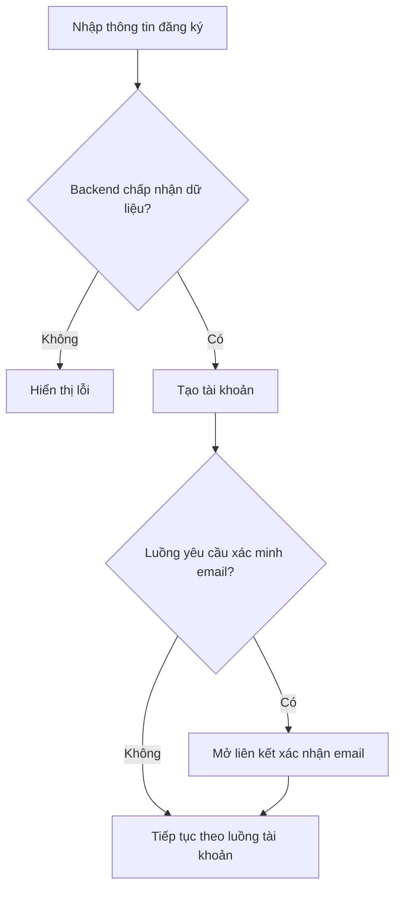
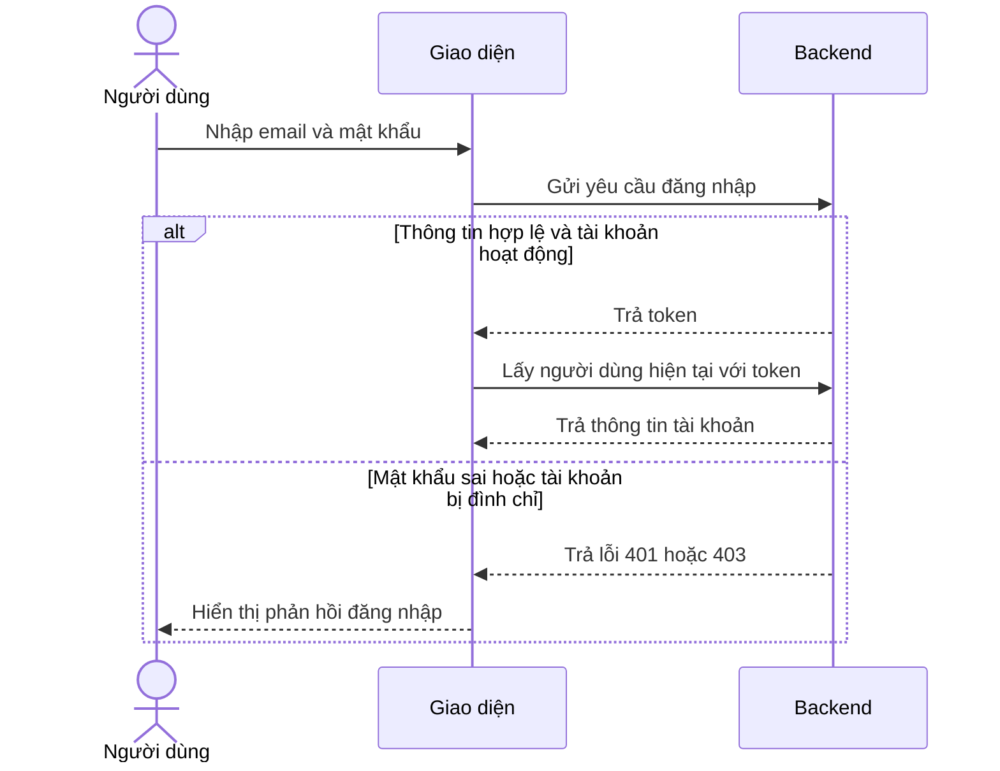

# Tài khoản và xác thực

Khách có thể đăng ký, xác minh email, đăng nhập hoặc khôi phục mật khẩu theo cấu hình hệ thống. Thành viên đã xác thực có thể truy cập hồ sơ của mình. Quản trị viên đăng nhập qua giao diện admin và cần quyền tương ứng với thao tác.

- **UC-AUTH-01 — Đăng ký và xác minh.** Nhập thông tin tài khoản ở màn hình đăng ký. Backend kiểm tra dữ liệu và tính duy nhất của email. Nếu luồng yêu cầu xác minh, mở liên kết trên màn hình xác nhận.
- **UC-AUTH-02 — Đăng nhập.** Gửi thông tin xác thực từ màn hình đăng nhập. Khi thành công, giao diện có thể gọi endpoint lấy người dùng hiện tại. Sai mật khẩu trả `401`, còn tài khoản bị đình chỉ trả `403`. Giao diện admin có màn hình đăng nhập riêng.
- **UC-AUTH-03 — Khôi phục mật khẩu.** Khi backend bật khôi phục, giao diện cung cấp đường dẫn yêu cầu đặt lại. Người dùng mở liên kết nhận được để tới màn hình đặt mật khẩu mới.
- **UC-AUTH-04 — Phiên và hồ sơ.** Dùng phiên hợp lệ để truy cập hồ sơ và cập nhật thông tin cá nhân. API bảo vệ từ chối yêu cầu không có phiên hợp lệ.

Đối chiếu [route giao diện](../../../frontend/src/App.tsx), [API](../../openapi.yaml), [ERD](../../ERD.md) và [ca kiểm thử](testing.md). Luồng hướng dẫn người dùng mới thuộc nhóm onboarding trong [mục lục](../../README.md).

## Tương tác khi đăng nhập

