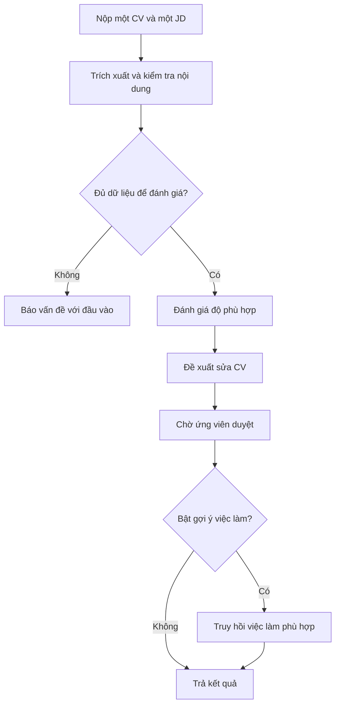

# Check CV

**Trạng thái: Dự kiến.** Trang này ghi phạm vi sản phẩm đã mô tả trong kế hoạch Check CV v4. Các nhánh dưới đây cần xác nhận khi triển khai.

## UC-CV-01 — Đánh giá CV theo mô tả công việc

Ứng viên cung cấp một CV và một mô tả công việc (JD) mỗi lượt. Kết quả dự kiến gồm đánh giá độ phù hợp và đề xuất sửa CV để ứng viên duyệt. Gợi ý việc làm mặc định bật và có thể tắt trên biểu mẫu. Các màn hình cần mô tả khi triển khai gồm biểu mẫu khởi chạy, tiến độ, kết quả đánh giá và duyệt chỉnh sửa.

Xem [thiết kế](design.md), [ca kiểm thử](testing.md), [huấn luyện](ml/training.md) và [đánh giá mô hình](ml/evaluation.md).
