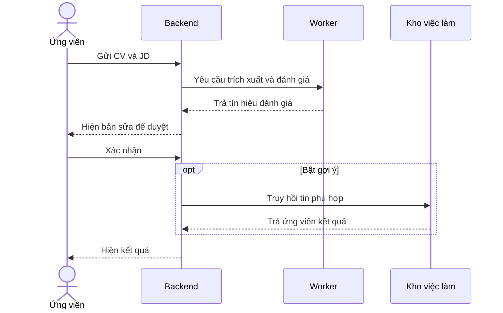

# Thiết kế Check CV

**Dự kiến theo kế hoạch Check CV v4, mục 5–7.** Cập nhật sơ đồ và liên kết tới mã, hợp đồng và migration khi triển khai.

- Ưu tiên trích xuất PDF trong worker. Dự kiến chuyển sang xử lý ảnh nếu trích xuất văn bản không đủ. Cần xác minh ranh giới giữa fallback và yêu cầu che dữ liệu cá nhân trước khi gửi nội dung ra ngoài. Ca nghiệm thu phải kiểm tra payload tại ranh giới này.
- Mô hình dùng để tính tín hiệu phù hợp CV–JD và mã hóa tài liệu cho truy hồi. Dẫn phiên bản mô hình đang phục vụ về [quy trình huấn luyện](ml/training.md).
- Công cụ nhập kho việc làm dự kiến lưu nguồn và thời hạn của tin. Liên kết tới migration thực tế và cập nhật [ERD](../../ERD.md) khi có schema.
