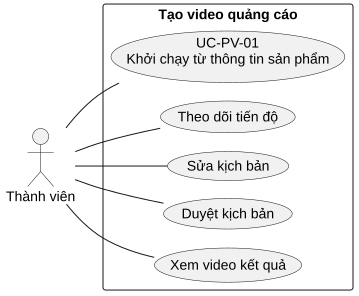
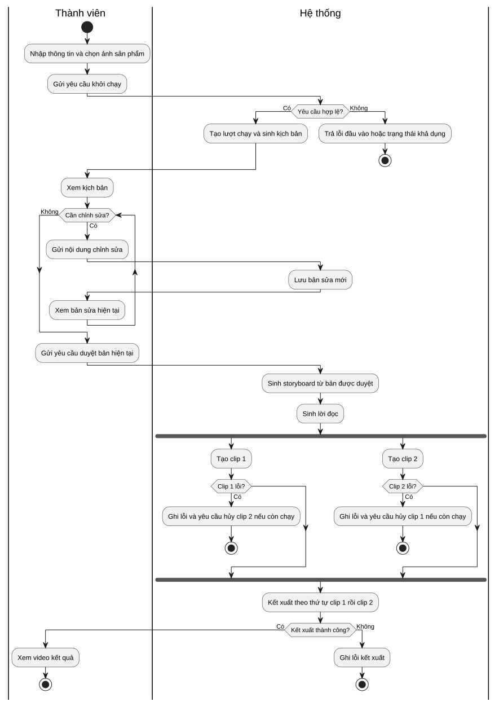
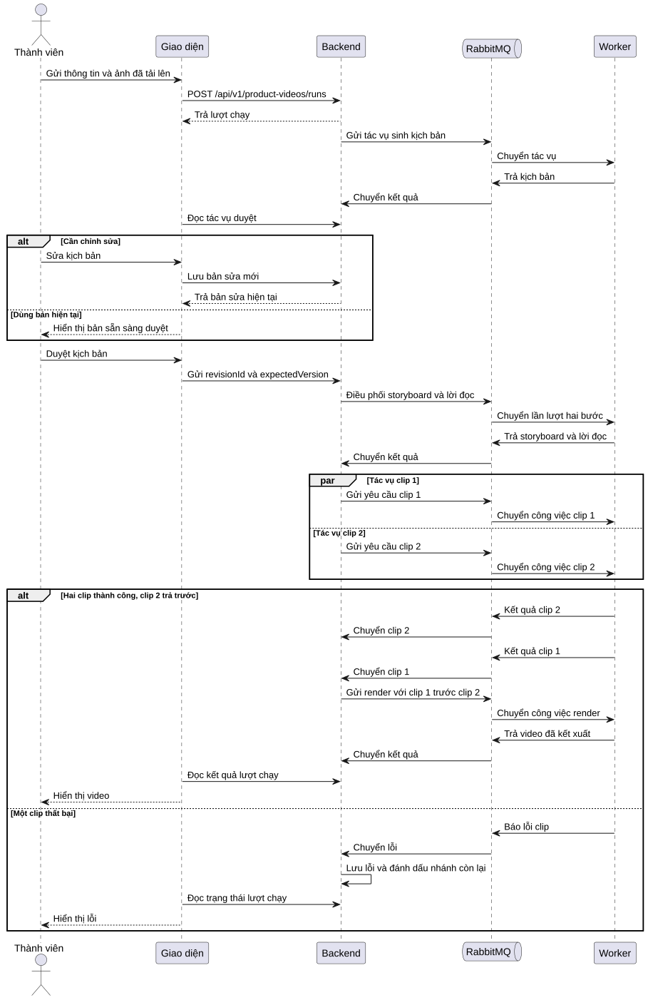
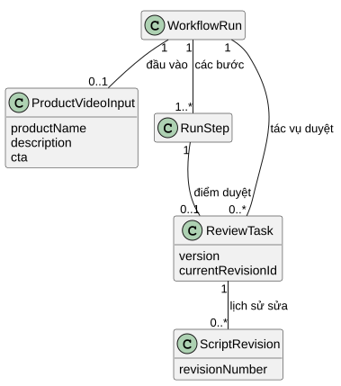

# Tạo video quảng cáo

## UC-PV-01 — Tạo video từ thông tin sản phẩm

- **Tác nhân** — Thành viên khởi chạy và duyệt kịch bản của lượt chạy.
- **Điều kiện trước** — Thành viên đã đăng nhập, tính năng khả dụng và ảnh tham chiếu đã được tải lên theo yêu cầu của biểu mẫu.
- **Luồng chính** — Thành viên gửi thông tin sản phẩm và theo dõi lượt chạy. Hệ thống sinh kịch bản và chờ duyệt. Sau khi thành viên duyệt, hệ thống sinh storyboard và lời đọc, điều phối hai tác vụ tạo clip rồi kết xuất.
- **Luồng thay thế** — Thành viên có thể sửa kịch bản trước khi duyệt. Hệ thống lưu bản sửa mới và yêu cầu duyệt đúng bản hiện tại. Nếu thao tác duyệt dùng phiên bản đã cũ, API trả `409`. Nếu một clip lỗi, backend ghi lỗi gốc, yêu cầu hủy nhánh còn lại và bỏ qua kết quả đến muộn.
- **Kết quả** — Thành viên xem video quảng cáo dài 10 giây khi kết xuất thành công. [Định nghĩa thời lượng](../../../backend/modules/workflow/src/main/java/com/flowcortex/workflow/api/ProductVideoWorkflow.java)

## Sơ đồ use case

Các thao tác của thành viên nằm trong ranh giới tính năng. [Nguồn PlantUML](diagrams/source/use-case.puml)

## Sơ đồ hoạt động

Hai nhánh tạo clip hội tụ trước khi kết xuất. [Nguồn PlantUML](diagrams/source/activity.puml) · [Migration storyboard](../../../backend/boot/app/src/main/resources/db/migration/V2026.10.17.002__product_video_visual_storyboard.sql) · [PV-IT-03](testing.md#pv-it-03)

## Sơ đồ tuần tự

Ví dụ thành công cho thấy clip 2 trả trước nhưng backend vẫn gửi clip 1 trước clip 2 trong đầu vào kết xuất. Nhánh lỗi cho thấy cách backend xử lý một clip thất bại. [Nguồn PlantUML](diagrams/source/sequence.puml) · [PV-IT-01](testing.md#pv-it-01) · [PV-IT-02](testing.md#pv-it-02)

## Sơ đồ lớp miền

Sơ đồ mô tả dữ liệu đầu vào, lượt chạy, các bước, tác vụ duyệt và lịch sử bản sửa. [Nguồn PlantUML](diagrams/source/domain-class.puml) · [ERD](../../ERD.md) · [Kiến trúc dùng chung](../../ARCHITECTURE.md)
