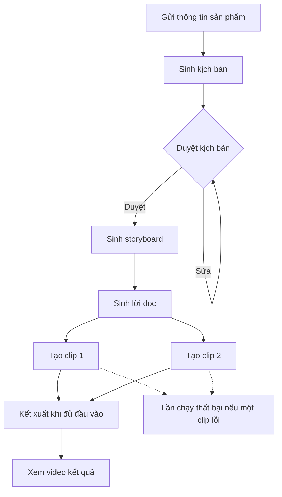
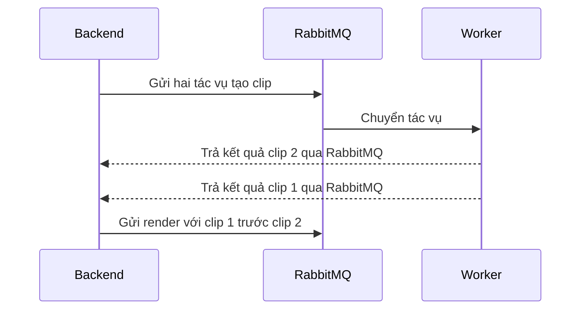

# Tạo video quảng cáo

## UC-PV-01 — Tạo video từ thông tin sản phẩm

Thành viên mở biểu mẫu tạo video, nhập thông tin sản phẩm và cung cấp hình tham chiếu theo yêu cầu của biểu mẫu. Khi workflow khả dụng, người dùng khởi chạy và theo dõi tiến độ. Workflow tạo kịch bản, chờ duyệt, sinh storyboard và lời đọc, tạo hai clip, rồi kết xuất video. Độ dài video là 10 giây theo [ProductVideoWorkflow](../../../backend/modules/workflow/src/main/java/com/flowcortex/workflow/api/ProductVideoWorkflow.java).

Biểu mẫu khởi chạy và màn hình theo dõi là hai điểm tương tác chính. Khi một clip thất bại, backend có thể yêu cầu hủy clip còn lại và loại bỏ kết quả đến muộn. Xem [migration storyboard](../../../backend/boot/app/src/main/resources/db/migration/V2026.10.17.002__product_video_visual_storyboard.sql), [ca kiểm thử](testing.md) và [kiến trúc dùng chung](../../ARCHITECTURE.md).
