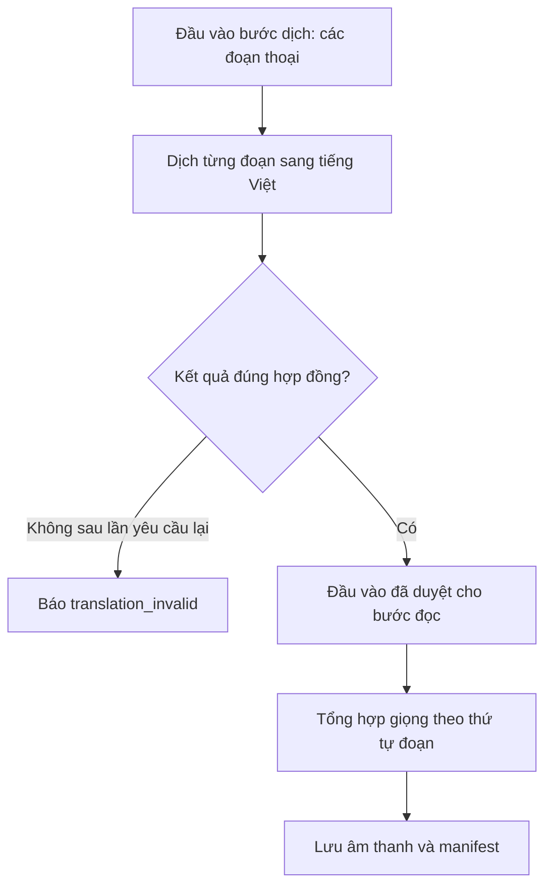

# Dịch video tiếng Trung

## UC-VT-01 — Chuyển lời thoại sang tiếng Việt

Thành viên muốn nhận bản tiếng Việt từ video tiếng Trung. Trong checkout này, có thể xác minh riêng bước dịch các đoạn thoại và bước tổng hợp giọng nói từ các dòng đã duyệt. Khi mô tả một lượt chạy cụ thể, cần đối chiếu định nghĩa workflow được triển khai để xác nhận nguồn video, các bước đứng trước/sau và tệp cuối cùng người dùng nhận.

Sơ đồ bao quát phần xử lý có bằng chứng trong [TranslateStepExecutor](../../../backend/modules/workflow/src/main/java/com/flowcortex/workflow/application/TranslateStepExecutor.java) và [TtsStepExecutor](../../../backend/modules/workflow/src/main/java/com/flowcortex/workflow/application/TtsStepExecutor.java). Nhánh từ chối của nhà cung cấp và lỗi dịch vụ được ghi trong [ca kiểm thử](testing.md). Điều kiện khả dụng phụ thuộc cấu hình và nhà cung cấp.

Seed [Douyin Video Repurpose](../../../backend/boot/app/src/main/resources/db/migration/V2026.10.02.002__douyin_workflow_seed.sql) chứa ba bước `echo_input`, `approval_checkpoint` và `echo_output`. Định nghĩa đầy đủ ghép các bước dịch và lồng tiếng trên môi trường đích vẫn cần được xác nhận.
