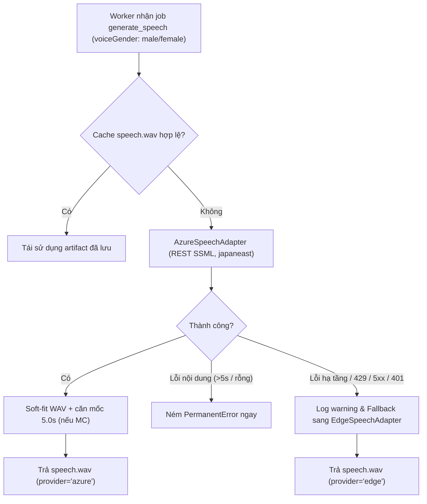

# Kế Hoạch & Checklist Triển Khai: Azure AI Speech TTS (Nam/Nữ) + Fallback Edge TTS

> **Trạng thái**: Hoàn tất 100% (đã chạy smoke test thật Azure `japaneast` cả giọng Nam & Nữ)  
> **Ngày lập**: 2026-11-23  
> **Khu vực Azure mặc định**: `japaneast` (`https://japaneast.tts.speech.microsoft.com/cognitiveservices/v1`)

---

## 1. Mục Tiêu & Nguyên Tắc Thiết Kế

- **TTS chính**: Dùng **Azure AI Speech REST API** (chỉ dùng `urllib.request` chuẩn của Python, không cài thêm native SDK nặng).
- **Hỗ trợ tùy chọn giọng Nam / Nữ**:
  - Giọng Nam: `vi-VN-NamMinhNeural`
  - Giọng Nữ: `vi-VN-HoaiMyNeural` (khắc phục lỗi `NoAudioReceived` hay gặp trên Edge WebSocket)
  - Nối trực tiếp với trường `voiceGender` (`male` | `female`) đã có sẵn từ Frontend → Backend → Worker.
- **Định dạng đầu ra chuẩn**: `X-Microsoft-OutputFormat: riff-24khz-16bit-mono-pcm` (WAV 24kHz mono 16-bit khớp ngay `_validate_wav()`).
- **Fallback tự động sang Edge TTS (`FallbackSpeechAdapter`)**:
  - **Kích hoạt fallback**: Lỗi mạng, timeout, HTTP `408`/`429` (rate limit / hết quota), `5xx`, hoặc lỗi xác thực/endpoint (`401`/`403`) từ Azure → ghi log cảnh báo có cấu trúc (`speech_provider_fallback`) và tự động chuyển sang `EdgeSpeechAdapter`.
  - **Không fallback**: Lỗi nội dung kịch bản (kịch bản trống, đoạn thoại MC > `5000ms`, đoạn thoại SP > `5000ms`) → ném `PermanentError` ngay để người dùng rút gọn lời, không gọi lặp sang Edge.
  - **Ghi nhận minh bạch**: `manifest.json` và `ProviderSpeechData.provider` ghi đúng nhà cung cấp thực tế đã tạo WAV (`"azure"` hoặc `"edge"`).
- **Không cần đổi DB migration hay JSON Schema**: `contracts/provider-speech-result.schema.json` và `ProviderSpeechData.java` đã cho phép `provider` là chuỗi `1..50` ký tự.
- **Bảo mật khóa**: Tuyệt đối không ghi `AZURE_SPEECH_KEY` vào mã nguồn hay git; chỉ đọc từ `.env` cục bộ (gitignored).

---

## 2. Kiến Trúc Luồng Xử Lý



---

## 3. Phạm Vi File Thay Đổi & Checklist

### Worker (`worker/src/flowcortex_worker/provider/`)
- [x] **[NEW] `azure_adapter.py`**:
  - `PROVIDER_AZURE = "azure"`, `AzureSpeechConfig`, `azure_config_from_env()`.
  - `AzureSpeechAdapter`: build SSML có XML escape + `<prosody rate="...">`, chọn giọng theo `voiceGender` / `request.voice`, hỗ trợ chế độ 1 đoạn (Showroom, soft-fit `<= 10.0s`) và 2 đoạn căn mốc `5.0s` (MC, kiểm tra chặt cả 2 cảnh `<= 5.0s`).
  - `FallbackSpeechAdapter(primary, fallback)`: bắt `TransientError` và lỗi hạ tầng/auth của Azure để fallback sang `EdgeSpeechAdapter`; giữ nguyên `PermanentError` về độ dài/nội dung.
- [x] **[MODIFY] `edge_adapter.py`**:
  - Chia sẻ helper xử lý WAV/alignment (`resolve_edge_voice`, `_validate_wav`, `_concat_aligned_wav`, `_to_wav`, `_rate_factor`) để `azure_adapter.py` tái sử dụng trực tiếp.
- [x] **[MODIFY] `capabilities.py`**:
  - Hỗ trợ resolve giọng Nam/Nữ cho cả `azure` và `edge`.
  - Cập nhật kiểm tra identity sau `adapter.generate_speech(...)`: chấp nhận `speech.provider` là `identity.provider` hoặc `"edge"` khi fallback kích hoạt, ghi đúng `speech.provider` vào `manifest.json`.
- [x] **[MODIFY] `__main__.py`**:
  - Hỗ trợ `SPEECH_PROVIDER=azure` trong `_build_speech_adapter(...)`.
  - Bọc `FallbackSpeechAdapter(AzureSpeechAdapter, EdgeSpeechAdapter)` khi `SPEECH_FALLBACK_PROVIDER=edge` (mặc định), cho phép tắt khi `SPEECH_FALLBACK_PROVIDER=none`.

### Cấu hình môi trường
- [x] **[MODIFY] `.env.example`**: thêm `AZURE_SPEECH_KEY=`, `AZURE_SPEECH_REGION=japaneast`, `AZURE_SPEECH_VOICE=vi-VN-NamMinhNeural`, `AZURE_SPEECH_RATE=+10%`, `SPEECH_FALLBACK_PROVIDER=edge`.
- [x] **[MODIFY] `docker-compose.yml`** & **`infra/egress-proxy/acl.yaml`**: truyền các biến `AZURE_SPEECH_*` và `SPEECH_FALLBACK_PROVIDER` vào service `provider-worker`, mở allowlist `'*.tts.speech.microsoft.com'`.

### Kiểm thử
- [x] **[NEW] `worker/tests/test_azure_adapter.py`**:
  - Test SSML escaping + chọn giọng Nam / Nữ theo `voiceGender`.
  - Test chế độ 2 đoạn MC căn mốc `5.0s` và từ chối đoạn thoại > `5000ms`.
  - Test `FallbackSpeechAdapter` khi Azure trả `429` / `500` / `401` / timeout → fallback sang Edge (`provider="edge"`).
  - Test không fallback khi lỗi độ dài thoại (`PermanentError`).
  - Test `_generate_speech` trong `capabilities.py` chấp nhận kết quả fallback và `_build_speech_adapter` trong `__main__.py`.

---

## 4. Kế Hoạch Xác Minh

### Automated Tests
```powershell
$env:UV_PROJECT_ENVIRONMENT="$PWD\tmp\worker-venv"
uv run --project worker ruff check worker/src worker/tests
uv run --project worker mypy --ignore-missing-imports worker/src/flowcortex_worker/provider/azure_adapter.py worker/src/flowcortex_worker/provider/edge_adapter.py worker/src/flowcortex_worker/provider/capabilities.py
uv run --project worker pytest -q worker/tests/test_azure_adapter.py worker/tests/test_edge_adapter.py worker/tests/test_provider_capabilities.py
```

### Kiểm thử thật trên Azure (`japaneast`)
- [x] Điền `AZURE_SPEECH_KEY` vào `.env` cục bộ.
- [x] Chạy smoke test gọi thật Azure `japaneast` tạo 2 file nghe thử:
  - `tmp/azure_test_nu.wav` (`vi-VN-HoaiMyNeural`, `3625ms`, `174 KB`)
  - `tmp/azure_test_nam.wav` (`vi-VN-NamMinhNeural`, `3579ms`, `171 KB`)
- [x] Xác nhận file WAV chuẩn `24000 Hz`, mono, 16-bit, âm thanh rõ ràng ở cả 2 giọng.
